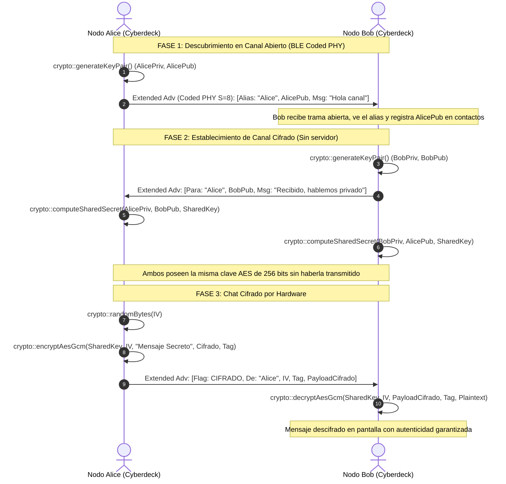

# 🔐 Especificación Técnica: Servicio Global de Criptografía por Hardware (`CryptoService`)

**Fecha:** 1 de Noviembre de 2026  
**Estado:** Propuesta de Arquitectura / Pendiente de Implementación  
**Categoría:** Arquitectura Core / Seguridad Embebida / Networking  
**Módulos Afectados:** `core/include/cbdos/crypto.hpp`, `core/src/security/CryptoService.cpp`  
**Consumidores Previstos:** BLE Táctico Chat, Comunicaciones P2P, Storage Seguro, Futuras utilidades del sistema  

---

## 🎯 1. Motivación y Principios de Diseño

### 1.1. Contexto Actual en CBDos
Actualmente, las capacidades criptográficas de CBDos se encuentran dispersas en subsistemas con propósitos muy específicos:
* `cbdos::security::VaultService`: Cifrado local de credenciales atado a desbloqueo por PIN de usuario y persistencia en `/cbdos/vault/`.
* `Kerberos` (`core/src/security/kerberos/`): Criptografía orientada exclusivamente al protocolo de autenticación física FIDO2/WebAuthn (CTAP2).
* `LockService`: Funciones PBKDF2 dedicadas al bloqueo y PIN maestro del dispositivo.

Cualquier módulo nuevo (como el chat táctico sobre BLE Coded PHY) que requiera cifrar paquetes en tránsito o negociar claves se ve forzado a invocar directamente librerías externas o detalles de bajo nivel del hardware. Esto viola el principio de abstracción de CBDos.

### 1.2. Principio de No Regresión (*Zero Regressions Policy*)
* **Las aplicaciones y servicios existentes no se tocan:** `VaultService`, `Kerberos` y `LockService` mantendrán intacto su código y funcionamiento para garantizar la estabilidad total del sistema operativo.
* **Adopción gradual hacia adelante (*Fix-forward*):** `CryptoService` se crea como un nuevo ciudadano de primer nivel en el Core. Las nuevas aplicaciones (comenzando por el Chat BLE) se desarrollarán directamente sobre este nuevo servicio. En el futuro, los módulos legados podrán ser refactorizados para consumir esta misma API sin prisas ni riesgos.

### 1.3. Principio de Aceleración por Hardware Transparente
Las aplicaciones de usuario y vistas LVGL no deben conocer qué registros, interrupciones o coprocesadores de silicio se emplean. El servicio en el Core delega las operaciones a los aceleradores criptográficos por hardware disponibles en el SoC:
* **ESP32-S3:** Acelerador AES (GCM por hardware), coprocesador SHA, motor de grandes números (RSA/ECC) y TRNG de radio.
* **ESP32-P4:** Acelerador criptográfico integrado en la arquitectura RISC-V de alto rendimiento.

---

## 🎛️ 2. Arquitectura del Sistema

```
┌────────────────────────────────────────────────────────┐
│               APLICACIONES Y SERVICIOS                 │
│         (BleChatView, Transceptores, etc.)            │
└───────────────────────────┬────────────────────────────┘
                            │  Llamadas API de alto nivel (std::vector, strings)
                            ▼
┌────────────────────────────────────────────────────────┐
│             cbdos::crypto (Core API)                   │
│          core/include/cbdos/crypto.hpp                 │
└───────────────────────────┬────────────────────────────┘
                            │  Implementación desacoplada
                            ▼
┌────────────────────────────────────────────────────────┐
│                 CryptoService Backend                  │
│          core/src/security/CryptoService.cpp           │
└───────────────────────────┬────────────────────────────┘
                            │  Capa de portabilidad (mbedtls hardware-backed)
            ┌───────────────┴───────────────┐
            ▼                               ▼
┌───────────────────────┐       ┌───────────────────────┐
│     ESP32-S3 HAL      │       │     ESP32-P4 HAL      │
│  - HW AES Engine      │       │  - HW Crypto Unit     │
│  - HW SHA Engine      │       │  - TRNG RISC-V        │
│  - HW ECC Engine      │       │  - HW ECC Engine      │
│  - TRNG RF Noise      │       │                       │
└───────────────────────┘       └───────────────────────┘
```

---

## 💻 3. Contrato de la API Pública (`core/include/cbdos/crypto.hpp`)

El servicio residirá en el namespace `cbdos::crypto` y expondrá únicamente tipos estándar de C++:

```cpp
#pragma once

#include <cstdint>
#include <cstddef>
#include <vector>
#include <string>

namespace cbdos {
namespace crypto {

// Longitudes criptográficas estándar
constexpr size_t AES_KEY_SIZE_256  = 32; // 256 bits
constexpr size_t AES_GCM_IV_SIZE   = 12; // 96 bits (recomendado para GCM)
constexpr size_t AES_GCM_TAG_SIZE  = 16; // 128 bits de autenticación
constexpr size_t SHA256_HASH_SIZE  = 32; // 256 bits
constexpr size_t ECC_PUBKEY_SIZE   = 65; // P-256 no comprimida (0x04 + X[32] + Y[32])
constexpr size_t ECC_PRIVKEY_SIZE  = 32; // P-256 escalar privado (32 bytes)

// ===========================================================================
// 1. Entropía y Números Aleatorios Reales (TRNG)
// ===========================================================================

/**
 * @brief Rellena un búfer con bytes aleatorios generados por el TRNG de silicio.
 * @param out Puntero al búfer de destino.
 * @param len Cantidad de bytes a generar.
 * @return true si la generación fue exitosa y cryptográficamente segura.
 */
bool randomBytes(uint8_t* out, size_t len);

// ===========================================================================
// 2. Cifrado y Descifrado Autenticado por Hardware (AES-256-GCM)
// ===========================================================================

/**
 * @brief Cifra datos usando AES-256-GCM acelerado por hardware con autenticación.
 * @param key Clave de 32 bytes (256 bits).
 * @param iv Vector de inicialización de 12 bytes (único por mensaje).
 * @param plaintext Puntero a los datos claros.
 * @param plainLen Longitud de los datos claros.
 * @param outCipher Vector de salida que contendrá el texto cifrado.
 * @param outTag Búfer de salida de 16 bytes para la etiqueta de autenticación (MAC).
 * @param aad Datos adicionales autenticados (opcional, no se cifran pero se protegen).
 * @param aadLen Longitud del AAD.
 * @return true si el cifrado fue completado por el coprocesador.
 */
bool encryptAesGcm(const uint8_t key[AES_KEY_SIZE_256],
                   const uint8_t iv[AES_GCM_IV_SIZE],
                   const uint8_t* plaintext, size_t plainLen,
                   std::vector<uint8_t>& outCipher,
                   uint8_t outTag[AES_GCM_TAG_SIZE],
                   const uint8_t* aad = nullptr, size_t aadLen = 0);

/**
 * @brief Descifra y valida la autenticidad de datos cifrados con AES-256-GCM.
 * @param key Clave de 32 bytes.
 * @param iv Vector de inicialización de 12 bytes.
 * @param ciphertext Puntero a los datos cifrados.
 * @param cipherLen Longitud de los datos cifrados.
 * @param tag Etiqueta de autenticación de 16 bytes recibida.
 * @param outPlain Vector de salida con el texto en claro.
 * @param aad Datos adicionales autenticados (deben coincidir exactamente con el emisor).
 * @param aadLen Longitud del AAD.
 * @return true si la autenticación y descifrado fueron válidos; false si hubo manipulación.
 */
bool decryptAesGcm(const uint8_t key[AES_KEY_SIZE_256],
                   const uint8_t iv[AES_GCM_IV_SIZE],
                   const uint8_t* ciphertext, size_t cipherLen,
                   const uint8_t tag[AES_GCM_TAG_SIZE],
                   std::vector<uint8_t>& outPlain,
                   const uint8_t* aad = nullptr, size_t aadLen = 0);

// ===========================================================================
// 3. Funciones Hash Criptográficas (SHA-256)
// ===========================================================================

/**
 * @brief Calcula el hash SHA-256 de un flujo de bytes acelerado por hardware.
 */
bool sha256(const uint8_t* input, size_t len, uint8_t outHash[SHA256_HASH_SIZE]);

// ===========================================================================
// 4. Intercambio de Claves Asimétricas (ECDH secp256r1)
// ===========================================================================

struct KeyPair {
    uint8_t publicKey[ECC_PUBKEY_SIZE];   // Clave pública (para emitir por radio)
    uint8_t privateKey[ECC_PRIVKEY_SIZE]; // Clave privada (permanece local en memoria)
};

/**
 * @brief Genera un par de claves efímeras ECDH en la curva P-256.
 */
bool generateKeyPair(KeyPair& outKeys);

/**
 * @brief Calcula el secreto compartido (32 bytes) a partir de mi clave privada
 *        y la clave pública del contacto recibida por el aire.
 */
bool computeSharedSecret(const uint8_t myPrivKey[ECC_PRIVKEY_SIZE],
                         const uint8_t peerPubKey[ECC_PUBKEY_SIZE],
                         uint8_t outSharedKey[AES_KEY_SIZE_256]);

} // namespace crypto
} // namespace cbdos
```

---

## 📻 4. Aplicación en el Chat Táctico BLE (Flujo de Operación)

El Chat BLE utilizará este servicio para ofrecer **descubrimiento abierto por defecto** y **cifrado punto a punto bajo demanda**:



### 4.1. Estructura del Datagrama Táctico (Hasta 250 Bytes)
```
┌──────────┬──────────────┬─────────────┬──────────┬──────────┬────────────────────────┐
│ Magic    │ Flags / Tipo │ Remitente   │ IV (GCM) │ Tag      │ Carga Útil             │
│ (2 B)    │ (1 B)        │ (8 B Alias) │ (12 B)   │ (16 B)   │ (Texto Claro o Cifrado)│
│ 0xCB 0x05│ 0x00=Abierto │ "ALICE"     │          │          │ Hasta 180 bytes        │
│          │ 0x01=Cifrado │             │          │          │                        │
└──────────┴──────────────┴─────────────┴──────────┴──────────┴────────────────────────┘
```

---

## 🛡️ 5. Matriz de Compatibilidad y Seguridad

1. **Rendimiento:** Las operaciones de AES-256-GCM y SHA-256 en el coprocesador del ESP32-S3 toman menos de **0.1 milisegundos**, sin impacto perceptible en la tasa de refresco de LVGL v9.5.
2. **Higiene de Memoria:** Los búferes con claves privadas o secretos compartidos se limpian con `memset(..., 0, ...)` inmediatamente después de usarse.
3. **Resistencia a Replay Attacks:** Cada paquete privado incluye un contador de secuencia o timestamp dentro de los datos autenticados (`AAD`).

---

## 📌 6. Próximos Pasos (Solo tras Aprobación del Usuario)

1. Crear `core/include/cbdos/crypto.hpp`.
2. Implementar `core/src/security/CryptoService.cpp` respaldado por `mbedtls` con soporte de hardware.
3. Compilar y verificar en PlatformIO (S3) y ESP-IDF (P4) que no haya warnings ni dependencias circulares.
4. Diseñar la capa de transporte BLE Coded PHY que consumirá esta API.

