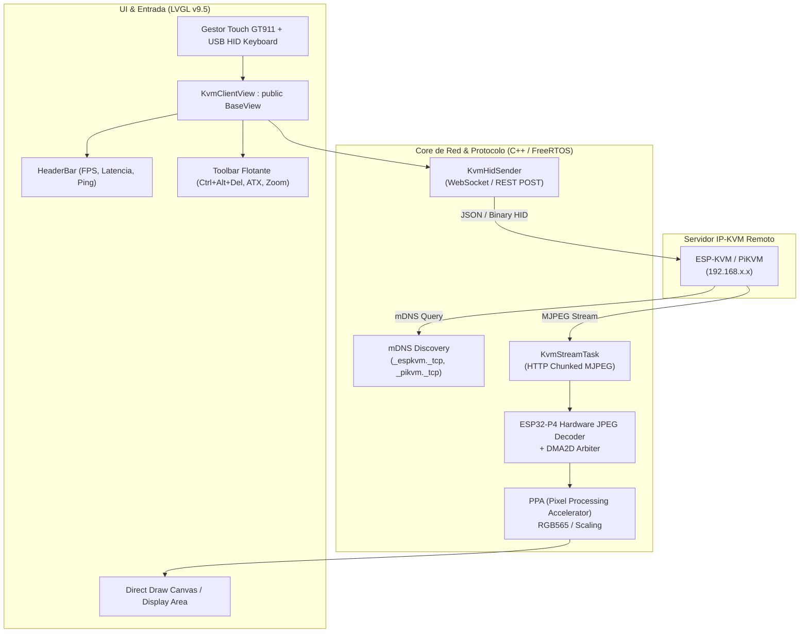

# 🖥️ Especificación Técnica: CBDos-KVM Client (Consola KVM Portátil)

**Fecha:** 1 de Noviembre de 2026  
**Estado:** Aprobado para Diseño y Desarrollo Clean-Room  
**Licencia de Referencia:** Apache License 2.0 (`espkvm/espkvm-term` & `espkvm/espkvm`)  
**Estrategia Arquitectónica:** 🧬 **Implementación Propia Basada en Referencia (`CLEAN-ROOM / INSPIRED`)**  
**Ubicación:** `specs/architecture/especificacion_tecnica_cbdos_kvm_client.md`  

---

## 1. Visión y Propósito del Módulo

**CBDos-KVM Client** convierte al Cyberdeck CBDos en una **consola física de rescate y administración remota fuera de banda (OOB - Out-of-Band Management)** para centros de datos, servidores de campo, homelabs y terminales industriales.

A diferencia de soluciones que requieren una laptop intermedia con navegador web, el Cyberdeck se conecta directamente a través de Wi-Fi o Ethernet local a dispositivos IP-KVM (**ESP-KVM**, **PiKVM**, etc.) para:
1. Visualizar la pantalla del servidor objetivo en tiempo real (desde la BIOS/UEFI hasta el entorno gráfico del SO) mediante streaming MJPEG decodificado por silicio.
2. Controlar teclado y ratón utilizando la pantalla táctil y el **teclado físico USB Host** conectado al Cyberdeck.
3. Enviar comandos de ciclo de energía de hardware (Power ON, Reset, Hard Shutdown) e inyectar macros de sistema (`Ctrl+Alt+Del`, `SysRq`, `Alt+F1..F7`).

```
+-------------------------------------------------------------+
|                     SERVIDOR OBJETIVO                       |
|   (PC / Servidor Rack / Máquina Industrial / Firewall)      |
+-------------------------------------------------------------+
          | Salida HDMI                    ^ USB Gadget (HID)
          v                                |
+-------------------------------------------------------------+
|                DISPOSITIVO IP-KVM REMOTO                    |
|             (ESP-KVM / PiKVM / Bidi-KVM)                    |
|  - Servidor HTTP/WebSocket (Stream MJPEG + API HID)         |
+-------------------------------------------------------------+
                                ^
                                | Wi-Fi 802.11 / LAN (mDNS)
                                v
+-------------------------------------------------------------+
|                  CYBERDECK CBDos (CLIENTE)                  |
|                                                             |
|   [ ESP32-P4 JC4880P443C ] / [ ESP32-S3 JC3248W535 ]        |
|                                                             |
|  1. KvmClientService (Task RTOS, HTTP Chunked Parser)       |
|  2. Decodificador HW JPEG + Acelerador PPA (ESP32-P4)       |
|  3. KvmClientView (LVGL v9.5 + HeaderBar + Canvas Direct)   |
|  4. Subsystem USB Host HID / Touch GT911 (Ratón + Teclado)  |
+-------------------------------------------------------------+
```

---

## 2. Decisión Arquitectónica: ¿Por qué Cliente y no Servidor?

| Rol | Evaluación en Hardware CBDos | Decisión |
| :--- | :--- | :---: |
| **KVM Servidor (Host)** | Requeriría conectar una tarjeta hija de captura HDMI a MIPI-CSI (Toshiba TC358743) en el flex de cámara de la placa JC4880, obligando al Cyberdeck a quedar atado físicamente al PC objetivo en modo *headless*. | ❌ **Descartado para CBDos Core** (Rompe la naturaleza de estación Cyberdeck portátil interactiva). |
| **KVM Cliente (Viewer & Controller)** | Aprovecha la pantalla táctil DSI de 4.43", el teclado físico USB Host, la conectividad Wi-Fi y el silicio de decodificación acelerada (JPEG HW + PPA) del ESP32-P4 para operar como monitor/consola móvil. | ✅ **APROBADO (CBDos-KVM Client)** |

---

## 3. Arquitectura del Sistema: Módulos y Capas

La arquitectura sigue el principio estricto de desacoplamiento de CBDos: la capa de red y decodificación (`KvmClientService`) es completamente agnóstica a la interfaz gráfica (`KvmClientView`).



---

## 4. Pipeline de Video Acelerado por Hardware (ESP32-P4)

Para alcanzar una tasa fluida de **20–30 FPS a 720p (1280x720)** o reescalado a la resolución nativa de la pantalla JC4880 (**800x480**), se implementa un pipeline de decodificación por hardware de tres etapas:

### 4.1. Recepción y Backpressure (Inspirado en HomeTiles H3)
1. Conexión HTTP persistente `GET /stream.mjpeg` (o `/webstream/`).
2. Tarea FreeRTOS `KvmStreamTask` anclada al **Core 1** con prioridad 12 y stack de 8 KB.
3. Detección de delimitadores multipart (`--boundary`, cabecera `Content-Length:` y SOI JPEG `0xFFD8` / EOI `0xFFD9`).
4. **Triple Buffering en PSRAM:** Tres buffers dinámicos asignados con `MALLOC_CAP_SPIRAM`.
5. Si el consumidor de frames (decodificador) sufre retraso, la tarea de red descarta el frame entrante (*drop frame*) antes de alimentar el decodificador, garantizando **cero acumulación de latencia (ultra-low latency)**.

### 4.2. Decodificación Hardware y Protección DMA2D (Inspirado en HomeTiles H1)
1. El ESP32-P4 cuenta con un motor dedicado **JPEG Decoder Hardware**.
2. **Árbitro DMA2D:** Para evitar el bloqueo del hardware gráfico cuando el decodificador JPEG y el refresco DSI comparten el bus 2D (bug histórico `PPA wedged / error 259`), se envuelve la decodificación en el `Dma2dArbiterGuard`:
   ```cpp
   {
       Dma2dArbiterGuard guard(Dma2dChannel::JPEG_HW);
       esp_jpeg_decode(&decode_cfg, jpeg_buf, jpeg_len, out_rgb565_buf);
   }
   ```
### 4.2. Decodificación Hardware, Escalado y Rotación PPA (Modo Panorámico)
1. **El Problema del Modo Vertical (Portrait 480x800):**
   * Los servidores y PCs emiten señales en formato horizontal panorámico (16:9, 16:10 o 4:3, típicamente 1920x1080, 1280x720 o 1024x768).
   * Si se renderiza en la orientación vertical nativa de la placa JC4880 (480 px de ancho), un stream 16:9 quedaría reducido a solo **480 x 270 px**, dejando un 65% de franjas negras (*letterboxing*) y haciendo el texto de la BIOS o terminal completamente ilegible.
2. **Rotación Dinámica a Landscape (800 x 480 px):**
   * Al entrar a `KvmClientView`, el display conmuta a orientación horizontal panorámica mediante `lv_display_set_rotation(disp, LV_DISPLAY_ROTATION_90)`.
   * El stream 720p/1080p aprovecha **el 100% de la superficie visual útil** (800x450 px efectivos en 16:9 o 800x480 en 16:10), permitiendo una lectura nítida de fuentes monospace y elementos de escritorio.
   * Al cerrar la vista (`popView`), el destructor restaura la orientación vertical nativa del sistema.
3. **Aceleración PPA SRM (Scale-Rotate-Mirror):**
   * El ESP32-P4 integra el bloque de hardware **PPA SRM**. La rotación de 90°/270° y el reescalado bilineal se ejecutan directamente en hardware DMA sin coste de ciclos de CPU para los núcleos RISC-V.
   * **Árbitro DMA2D:** Se envuelve el pipeline en `Dma2dArbiterGuard` (portado de HomeTiles H1) para evitar colisiones entre el decodificador JPEG y el DMA2D del panel DSI:
   ```cpp
   {
       Dma2dArbiterGuard guard(Dma2dChannel::JPEG_HW);
       esp_jpeg_decode(&decode_cfg, jpeg_buf, jpeg_len, out_rgb565_buf);
       // PPA hardware scale + rotate a 800x480
       ppa_do_scale_rotate_mirror(ppa_handle, &srm_cfg);
   }
   ```
4. **Transformación Táctil en Caliente (Touch GT911):**
   * El driver de entrada adapta dinámicamente la matriz de calibración táctil: $(X_{rot}, Y_{rot}) = (Y_{raw}, H_{native} - 1 - X_{raw})$, manteniendo el alineamiento pixel-perfecto del puntero.

---

## 5. Mecanismo de Cifrado y Seguridad (Crypto, TLS y Bóveda)

La administración de servidores en entornos de producción exige estrictas garantías criptográficas para no exponer credenciales ni comandos en texto plano en la red. La arquitectura detallada de certificados y TLS se rige por [`especificacion_tecnica_pila_tls_https_y_gestion_certificados.md`](especificacion_tecnica_pila_tls_https_y_gestion_certificados.md):

### 5.1. Cifrado en Tránsito (TLS 1.3 / HTTPS / WSS)
* Servidores como **PiKVM** y **ESP-KVM** operan de forma predeterminada sobre **HTTPS** y WebSockets seguros (**WSS**) utilizando certificados X.509 locales o auto-firmados.
* **Aceleración Criptográfica por Silicio (ESP32-P4):**
  * CBDos utiliza los motores criptográficos por hardware del ESP32-P4 (detallados en [`especificacion_crypto_service_hardware_cbdos.md`](especificacion_crypto_service_hardware_cbdos.md)): **acelerador AES-256**, **SHA-512**, **RSA/ECC** y el generador de números aleatorios por hardware (**TRNG**).
  * Esto permite procesar el *handshake* TLS 1.3 y el descifrado simétrico del flujo continuo de video sin degradar la tasa de frames ni sobrecargar la CPU.
* **Validación de Certificados en LAN y Modo Híbrido:**
  * Soporte de modo estricto (con CA raíz personalizada importada desde la MicroSD o Mozilla CA Bundle) y modo permisivo con **modal interactivo de rescate en LVGL 9.5** ante certificados autofirmados locales.

### 5.2. Almacenamiento Seguro de Credenciales (`VaultService`)
* Las credenciales de acceso al KVM (usuarios, contraseñas de sesión de PiKVM, tokens de API o PIN de 2FA) **nunca se guardan en texto plano en la tarjeta SD ni en NVS descubierta**.
* Se integran con la **Bóveda Segura de CBDos** (`VaultService`):
  * Cifrado con **AES-256-GCM** autenticado.
  * Clave derivada mediante PBKDF2/HMAC vinculada a la clave maestra del usuario o a la semilla eFuse del silicio.

### 5.3. Túneles Remotos Seguros (WireGuard / Tailscale)
* Para administrar servidores fuera de la red local (ej. en centro de datos o nube privada), el servicio de red de CBDos puede encapsular el tráfico KVM a través de un túnel WireGuard/Tailscale autenticado de punto a punto.

---

## 6. Subsistema de Entrada y Control (Teclado y Ratón)

### 6.1. Pantalla Táctil (Touchpad / Puntero Absoluto)
El digitalizador capacitivo **Goodix GT911** de la pantalla soporta dos modos de operación conmutables en caliente:

1. **Modo Ratón Absoluto (Recomendado para Escritorios / BIOS):**
   * Las coordenadas táctiles $(X_{touch}, Y_{touch})$ se escalan a la resolución de la pantalla remota $(X_{target}, Y_{target})$ en un rango normalizado `[0 .. 32767]`.
   * Un toque rápido envía `LEFT_CLICK_DOWN` seguido de `LEFT_CLICK_UP`.
   * Arrastre sostenido envía evento de *drag* (selección de texto / ventanas).
2. **Modo Trackpad Relativo (Para máquinas virtuales o punteros sin aceleración):**
   * Desplazamiento por deltas $(\Delta X, \Delta Y)$.
   * Gestos multitáctiles: dos dedos para rueda de desplazamiento vertical (*mouse wheel*).
   * Gesto de pellizco (*pinch-to-zoom*) para acercar zonas críticas de la pantalla (hasta 4x digital).

### 6.2. Teclado Físico USB Host (Integración Slave_I S1)
* Cuando se conecta un teclado USB al puerto USB-A del Cyberdeck, el controlador `usb/hid_host` encola los *keycodes* de 8 bytes de acuerdo con el protocolo estándar USB HID Boot Keyboard.
* En lugar de procesar los caracteres localmente, el `KvmClientService` envía los paquetes de pulsación y liberación (*key down / key up*) directamente al servidor KVM vía WebSocket o REST POST:
  ```json
  {"type": "keydown", "code": "KeyA", "modifiers": ["Control", "Alt"]}
  ```

---

## 7. Interfaz de Usuario LVGL v9.5 (`KvmClientView`)

Siguiendo las directrices de `BaseView` y ergonomía táctica de CBDos:

```
+-------------------------------------------------------------+
| [<] KVM: srv-edge-01 (192.168.1.150)   [28 FPS | 18ms] [⚙️] | <- HeaderBar
+-------------------------------------------------------------+
|                                                             |
|                                                             |
|                ÁREA DE VIDEO REMOTO (CANVAS)                |
|             (Resolución escalada 800 x 448 px)              |
|                                                             |
|                                                             |
+-------------------------------------------------------------+
| [CAD] [SUPER] [ESC] [TAB] [KBD] [⚡ ATX] [RATÓN: ABS] [🔍]  | <- Barra Flotante
+-------------------------------------------------------------+
```

### Componentes de la Vista:
1. **HeaderBar de CBDos Integrada:**
   * Botón `<` de retroceso para desconexión limpia y liberación de memoria RAM/PSRAM en el destructor.
   * Nombre del host o dirección IP conectada.
   * Telemetría reactiva: FPS reales recibidos y tiempo de ida y vuelta (latencia de red en ms).
2. **Barra de Herramientas Flotante / Auto-ocultable:**
   * **`[CAD]`**: Disparo inmediato de la combinación `Ctrl + Alt + Del`.
   * **`[SUPER]`**: Tecla Windows / Menú Inicio del host.
   * **`[ESC]` / `[TAB]` / `[F1..F12]`**: Teclas esenciales para navegación por BIOS/UEFI.
   * **`[KBD]`**: Despliega el teclado virtual en pantalla de LVGL si no hay teclado USB conectado.
   * **`[⚡ ATX]`**: Menú modal con opciones de gestión de energía física:
     * *Power On (Pulsación corta)*
     * *Force Power Off (Pulsación sostenida > 5s)*
     * *Hardware Reset*
   * **`[RATÓN: ABS/REL]`**: Conmutador rápido entre modo pantalla táctil directa y trackpad.

---

## 8. Compatibilidad con Servidores IP-KVM Existentes

El cliente soportará dos dialectos de comunicación mediante una abstracción `IKvmProtocolBackend`:

| Servidor Soportado | Protocolo de Video | Endpoint de Control HID | Autenticación |
| :--- | :--- | :--- | :--- |
| **ESP-KVM** | HTTP Chunked MJPEG (`/stream.mjpeg`) | WebSocket binario / REST API (`/api/hid/event`) | Basic Auth / Token NVS |
| **PiKVM (v2, v3, v4)** | HTTP MJPEG (`/stream`) / WebRTC opcional | WebSocket uStreamer (`/ws`) + REST `/api/hid` | Cookie de sesión / X-CSRF-Token |
| **Bidi-KVM / Web-KVM Genérico** | Standard Motion JPEG | REST POST endpoints | Ninguna / HTTP Basic |

---

## 9. Hoja de Ruta de Implementación (Fases)

1. **Fase 1: Servicio Core de Protocolo y Streaming (`KvmClientService`)**
   * Cliente HTTP chunked en C++ con parsing de delimitadores JPEG.
   * Buffer circular en PSRAM con lógica de descarte de frames atrasados (*frame drop*).
2. **Fase 2: Pipeline Gráfico ESP32-P4 (JPEG HW + PPA)**
   * Integración de `esp_jpeg` asistido por hardware con guardia `Dma2dArbiterGuard`.
   * Redimensionamiento de imágenes por hardware directo al búfer de pantalla.
3. **Fase 3: Vista de Control LVGL 9.5 (`KvmClientView`)**
   * Creación de la vista derivada de `BaseView`.
   * Controles flotantes táctiles, selector de servidores descubiertos por mDNS y teclado en pantalla.
4. **Fase 4: Puente HID (Touch GT911 + Teclado Físico USB)**
   * Mapeo de toques absolutos a coordenadas del target.
   * Redirección de eventos del teclado USB Host de `Slave_I` hacia la conexión del servidor KVM.

