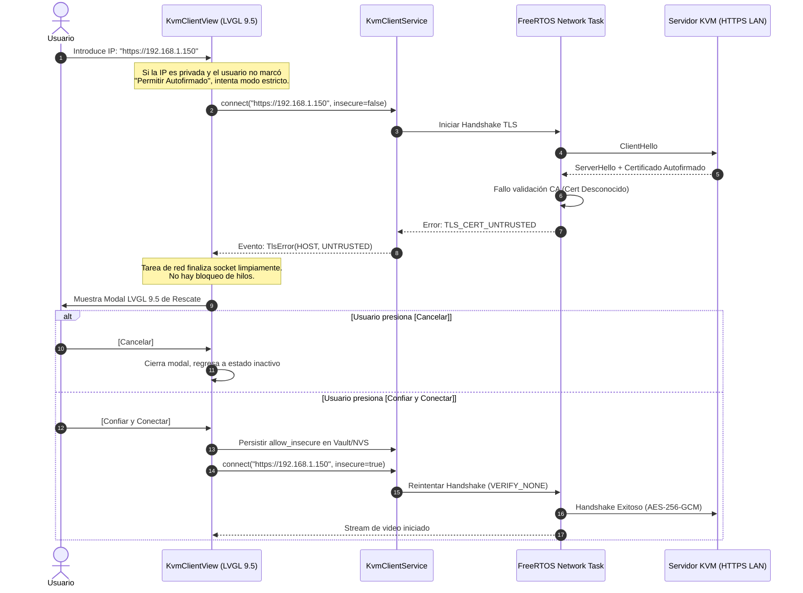

# 🔒 Especificación Técnica: Pila TLS/HTTPS y Gestión de Certificados en CBDos

**Fecha:** 1 de Noviembre de 2026  
**Estado:** Aprobado para Implementación  
**Ubicación:** `specs/architecture/especificacion_tecnica_pila_tls_https_y_gestion_certificados.md`  
**Módulos Impactados:** `core/include/cbdos/http.hpp`, `bsp/esp32_p4_jc4880/hal/hal_http_p4.cpp`, `bsp/esp32_s3_jc3248/hal/hal_http_s3.cpp`, `CBDos-KVM Client`, `VaultService`  

---

## 1. Propósito y Alcance

Esta especificación define la arquitectura unificada para el manejo de **conexiones seguras TLS 1.2 / TLS 1.3 (HTTPS y WebSockets seguros WSS)** en CBDos, resolviendo de forma nativa la gestión de certificados de seguridad en ambas plataformas objetivo (**ESP32-P4** y **ESP32-S3**).

El objetivo es proveer una pila criptográfica de red que soporte:
1. **Conexiones a Internet Público:** Validación estricta contra el catálogo raíz de autoridades de certificación reconocidas (Mozilla CA Bundle).
2. **Conexiones a Redes Locales / Homelabs / KVM:** Manejo ergonómico y seguro de **certificados autofirmados** en direcciones IP privadas sin colapsar la conexión.
3. **CAs Corporativas Personalizadas:** Carga opcional de certificados raíz `.pem` desde la tarjeta MicroSD.
4. **Patrón de UX Híbrido:** Combinación de switch de configuración explícito y **modal interactivo de rescate en LVGL 9.5** cuando se detecta un certificado autofirmado en caliente.

---

## 2. Diagnóstico del Estado Actual y Deuda Técnica

Tras auditar la implementación actual en el código fuente:

| Plataforma / Archivo | Estado Detectado | Problema / Riesgo | Corrección Requerida |
| :--- | :--- | :--- | :--- |
| **ESP32-P4** (`hal_http_p4.cpp`) | `CONFIG_MBEDTLS_CERTIFICATE_BUNDLE=y` está compilado, pero **no se enlaza** `esp_crt_bundle_attach`. | Peticiones a dominios HTTPS públicos legítimos fallan con `ESP_ERR_MBEDTLS_SSL_SETUP_FAILED`. | Adjuntar `config.crt_bundle_attach = esp_crt_bundle_attach;` si `!request.insecure`. |
| **ESP32-P4** (`sdkconfig`) | No está definido `CONFIG_ESP_TLS_SKIP_SERVER_CERT_VERIFY`. | `esp-tls` prohíbe conexiones a IPs con certificados autofirmados aunque `skip_cert_common_name_check` sea verdadero. | Habilitar `CONFIG_ESP_TLS_SKIP_SERVER_CERT_VERIFY=y` en el `sdkconfig` del P4. |
| **ESP32-S3** (`hal_http_s3.cpp`) | Usa `WiFiClientSecure.setInsecure()` cuando `request.insecure == true`. | Funciona para ignorar verificación, pero no permite validar CAs personalizadas ni extraer fingerprints SHA-256. | Extender soporte para certificados en buffer y captura de errores TLS. |
| **Contrato Core** (`http.hpp`) | `HttpRequest` tiene flag `bool insecure = true`, pero no reporta causa específica de fallo TLS. | La UI no puede distinguir entre un error de DNS/Timeout y un fallo de certificado autofirmado para mostrar el modal. | Añadir enum `TlsFailureReason` a `HttpResponse`. |

---

## 3. Modelo de Confianza de 3 Niveles

CBDos adopta una jerarquía de validación de certificados clara:

```
                                  Petición HTTPS / WSS
                                            │
                                            ▼
                           ¿Tiene CA personalizada en SD?
                                    /               \
                             SÍ    /                 \   NO
                                  ▼                   ▼
                           Validar contra        ¿`request.insecure`?
                           `custom_ca.pem`            /        \
                                               SÍ    /          \   NO
                                                    ▼            ▼
                                             Modo Tolerante   Validar contra
                                              (Autofirmado)   Mozilla Root Bundle
                                             MBEDTLS_VERIFY_  (esp_crt_bundle)
                                                  NONE
```

### Nivel 1: Certificados Públicos de Internet (Validación Estricta)
* Se activa cuando la URL apunta a un dominio FQDN y `insecure == false`.
* Utiliza el bundle comprimido de Mozilla integrado en flash mediante `esp_crt_bundle_attach` (en P4) o el almacén de confianza de Arduino (en S3).
* Verificación completa del Common Name (CN) y Subject Alternative Name (SAN).

### Nivel 2: Certificados Autofirmados de LAN / IP-KVM (Modo Insecure Inteligente)
* Típico en dispositivos de red local (`192.168.x.x`, `10.x.x.x`, `172.16.x.x..31.x.x`) como **ESP-KVM**, **PiKVM**, routers y switches administrables.
* Activa `MBEDTLS_SSL_VERIFY_NONE` y `skip_cert_common_name_check = true`.
* El tráfico viaja **completamente cifrado punto a punto con AES-GCM**, protegiendo contraseñas y video contra sniffing en el medio físico (cable/Wi-Fi), pero tolerando que la firma no provenga de una entidad comercial.

### Nivel 3: Autoridad de Certificación Propia (Enterprise / Homelab CA)
* Si en `/sdcard/cbdos/certs/ca.pem` existe un certificado raíz configurado, el motor inyecta el buffer PEM mediante `esp_transport_ssl_set_cert_data()` / `WiFiClientSecure::setCACert()`.
* Permite validar hosts locales con firmas internas sin perder el rigor criptográfico estricto.

---

## 4. Patrón de UX: Enfoque Híbrido (Switch + Modal de Rescate)

Para lograr la mejor experiencia táctil sin comprometer la estabilidad de las tareas FreeRTOS:



### 4.1. Diseño del Modal en LVGL 9.5
El modal se genera con las APIs modernas de LVGL 9.5 (`lv_msgbox_create`), con estilo táctico oscuro y botones ergonómicos para toque con dedo:

```
+-------------------------------------------------------------+
|               ⚠️ Certificado de Seguridad                   |
+-------------------------------------------------------------+
| El servidor en:                                             |
|   https://192.168.1.150:443                                 |
|                                                             |
| Presenta un certificado autofirmado no reconocido por       |
| autoridades públicas de Internet.                           |
|                                                             |
| La comunicación viajará CIFRADA, pero no se puede           |
| verificar la identidad oficial del emisor.                  |
|                                                             |
| ¿Deseas confiar en este servidor y guardar la excepción?    |
|                                                             |
|       [ Cancelar ]             [ Confiar y Conectar ]       |
+-------------------------------------------------------------+
```

---

## 5. Modificaciones en el Código Fuente

### 5.1. Actualización de Contratos en `core/include/cbdos/http.hpp`

```cpp
enum class TlsFailureReason {
    None,
    CertUntrusted,         // Certificado autofirmado o CA desconocida
    CertExpired,           // Certificado caducado
    CommonNameMismatch,    // El dominio no coincide con el certificado
    HandshakeFailed,       // Error genérico de cifrado / cipher mismatch
    IoTimeout              // Timeout de socket TCP
};

struct HttpRequest {
    HttpMethod method = HttpMethod::Get;
    std::string url;
    std::vector<HttpHeader> headers;
    std::string body;
    uint32_t timeoutMs = 8000;
    size_t maxBodyCaptureBytes = 32768;
    bool insecure = false;              // false por defecto (seguridad primero)
    std::string caCertPem;              // Opcional: Certificado CA en texto PEM
};

struct HttpResponse {
    int statusCode = 0;
    std::string statusText;
    std::vector<HttpHeader> headers;
    std::string body;
    uint32_t rttMs = 0;
    bool success = false;
    bool truncated = false;
    std::string errorMessage;
    TlsFailureReason tlsReason = TlsFailureReason::None; // Diagnóstico detallado
};
```

### 5.2. Actualización en `bsp/esp32_p4_jc4880/hal/hal_http_p4.cpp`

```cpp
#include <esp_crt_bundle.h>

// Dentro de execute():
if (isHttps) {
    if (!request.caCertPem.empty()) {
        config.cert_pem = request.caCertPem.c_str();
    } else if (request.insecure) {
        config.skip_cert_common_name_check = true;
        // Al estar activo CONFIG_ESP_TLS_SKIP_SERVER_CERT_VERIFY en sdkconfig,
        // no asignar crt_bundle_attach permite a esp-tls operar en MBEDTLS_SSL_VERIFY_NONE
    } else {
        config.crt_bundle_attach = esp_crt_bundle_attach;
    }
}
```

### 5.3. Actualización en `bsp/esp32_p4_jc4880/sdkconfig`
Añadir la opción para permitir el bypass cuando `request.insecure == true`:
```ini
CONFIG_ESP_TLS_SKIP_SERVER_CERT_VERIFY=y
```

---

## 6. Persistencia Segura de Excepciones de Confianza

Cuando el usuario pulsa **`[Confiar y Conectar]`**:
1. Se calcula la huella digital SHA-256 del certificado si está disponible o se registra la tupla `(Protocolo, IP/Host, Puerto)`.
2. Se almacena en la entrada correspondiente del servidor en `VaultService` (`kvm_hosts.json` cifrado con AES-256-GCM en NVS o MicroSD).
3. En futuras conexiones a ese mismo host, `KvmClientService` consulta la bóveda y asigna directamente `insecure = true`, evitando que el modal vuelva a aparecer repetitivamente.

---

## 7. Fases de Implementación

1. **Fase 1 (HAL & Kernel):**
   * Configurar `CONFIG_ESP_TLS_SKIP_SERVER_CERT_VERIFY=y` en el `sdkconfig` del ESP32-P4.
   * Conectar `esp_crt_bundle_attach` y soporte de CA en `hal_http_p4.cpp` y `hal_http_s3.cpp`.
2. **Fase 2 (Contrato HTTP):**
   * Añadir `TlsFailureReason` y campo `caCertPem` en `cbdos/http.hpp`.
3. **Fase 3 (UI de CBDos-KVM):**
   * Implementar switch `[x] Permitir autofirmados` en el modal de nuevo servidor.
   * Implementar widget modal de rescate en `KvmClientView` que capture fallos `CertUntrusted` y relance la conexión con un toque.

