# 🖥️ Especificación Técnica: Screen Share, Streaming de Pantalla y Grabación en PC

> **Estado:** Documento de Arquitectura Oficial (Aprobado para desarrollo)  
> **Fecha:** 22 de Octubre de 2026  
> **Ubicación:** `specs/architecture/especificacion_tecnica_screenshare_y_grabador_pc.md`  
> **Antecedente:** [proposal_screen_share_and_pc_recorder.md](file:///home/kaber420/Documentos/proyectos/cbdos/specs/proposals/proposal_screen_share_and_pc_recorder.md)  
> **Targets:** ESP32-P4 (JC4880P443C) como board principal y ESP32-S3 (JC3248W535) como target secundario  
> **Framework Gráfico:** LVGL v9.5 estricto  

---

## 1. Visión y Justificación Técnica

### 1.1 El Problema
Al desarrollar y depurar interfaces complejas en **CBDos** (menús dinámicos, consolas SSH, emuladores de terminal, herramientas de RF y scripts Lua), grabar la pantalla física con una cámara o teléfono resulta deficiente:
- Reflejos en el cristal, pérdida de enfoque y colores lavados.
- Imposibilidad de grabar a 60 FPS estables sin temblores.
- Cero interacción remota: se debe tocar la pantallita física con el dedo mientras se graba.

### 1.2 La Solución de CBDos
Implementar un subsistema unificado de captura y transmisión de pantalla (**`ScreenShareService`**) que:
1. **Opere en Silicio en el ESP32-P4:** Utilice el **PPA (Pixel Processing Accelerator)** y el **Encoder Hardware JPEG / H.264** para comprimir el framebuffer de LVGL v9.5 a 30–60 FPS con prácticamente **0% de impacto en la CPU**.
2. **Sea Plug & Play por USB y por Red:**
   - **Por USB CDC / Serial-JTAG:** Transmite frames comprimidos directamente por el cable USB a la PC sin necesidad de configurar Wi-Fi.
   - **Por Red LAN (HTTP / RTSP):** Expone un endpoint HTTP MJPEG (`http://<ip-cbdos>:8080/screen.mjpg`) que **OBS Studio** o **VLC** abren de forma nativa como fuente de video web.
3. **Ofrezca Control Táctil Remoto:** El PC envía eventos de clic/arrastre de ratón (`CBDOS:TOUCH:DOWN:x:y`) que se inyectan en el motor de eventos de LVGL v9.5, permitiendo controlar CBDos con el mouse mientras se graba.
4. **Zero Polling & Zero RAM en Inactividad:** Cuando el servicio está apagado, consume **0 bytes de RAM**. Al encenderse, reserva su buffer de trabajo en PSRAM y solo transmite cuando LVGL reporta áreas sucias (*dirty areas*).

---

## 2. Diagrama de Arquitectura del Sistema

```mermaid
flowchart TD
    subgraph UI["LVGL v9.5 Engine"]
        DISP["Display Buffer (RGB565 / ARGB8888 en PSRAM)"]
        HOOK["Dirty Area Hook / Flush Interceptor"]
        INDEV["Virtual Touch Indev (lv_indev_t)"]
    end

    subgraph Service["core/services/ScreenShareService"]
        STATE["Estado: IDLE / ACTIVE"]
        SNAP_BUF["Snapshot Draw Buffer en PSRAM"]
        QUEUE["Cola de Frames para Transmisión"]
    end

    subgraph HAL_P4["ESP32-P4 Hardware Pipeline (JC4880)"]
        PPA["PPA Hardware Accelerator (RGB to YUV / Format Convert)"]
        HW_ENC["JPEG Hardware Encoder (driver/jpeg_encode.h) / H.264"]
    end

    subgraph HAL_S3["ESP32-S3 Pipeline (JC3248)"]
        SW_RLE["Dirty Strip Detector + RLE RGB565 (Software liviano)"]
    end

    subgraph Transport["Capa de Transporte (Transmisor)"]
        USB_TX["USB CDC / Serial-JTAG ('CBSS' Framing)"]
        HTTP_TX["HTTP Server (Multipart MJPEG Stream)"]
    end

    subgraph PC["PC / Workstation (Consumidor)"]
        OBS["OBS Studio (Fuente Navegador / VLC RTSP)"]
        RECORDER["tools/cbdos_recorder.py (PyGame + FFmpeg + Inyección Touch)"]
    end

    HOOK -->|"Notifica Frame Sucio"| STATE
    STATE -->|"lv_snapshot_take_to_draw_buf()"| SNAP_BUF
    
    SNAP_BUF -->|"DMA Directo"| HAL_P4
    SNAP_BUF -->|"Buffer Copy"| HAL_S3

    HAL_P4 -->|"Frames Comprimidos (2-4 ms)"| QUEUE
    HAL_S3 -->|"Tiras Delta (5-15 ms)"| QUEUE

    QUEUE --> USB_TX
    QUEUE --> HTTP_TX

    USB_TX --> RECORDER
    HTTP_TX --> OBS
    HTTP_TX --> RECORDER

    RECORDER -.->|"Comandos CBDOS:TOUCH:x:y"| INDEV
```



---

## 3. Pipeline de Codificación por Plataforma (HAL)

### 3.1 ESP32-P4: Aceleración por Hardware (`bsp/esp32_p4_jc4880`)

El ESP32-P4 cuenta con buses AXI de alta velocidad y periféricos de imagen en silicio dedicados:

1. **Captura desde LVGL v9.5:**
   - La pantalla del panel JC4880 es `800x480` en RGB565 (o RGB888).
   - Tamaño del frame crudo: $800 \times 480 \times 2 = 768,000 \text{ bytes}$ (~750 KB).
2. **PPA (Pixel Processing Accelerator):**
   - Utiliza `driver/ppa.h` en modo SRM (Scale-Rotate-Mirror) o Color Conversion.
   - Aplica alineación estricta de 64 bytes para cache lines (`GALLERY_PPA_ALIGN = 64`).
3. **JPEG Hardware Encoder (`driver/jpeg_encode.h`):**
   - Comprime los 768 KB de imagen en un payload JPEG de **25 KB a 40 KB** en apenas **2.5 ms**.
   - Ratio de compresión: **~20:1 a 30:1**.
   - Ancho de banda a 30 FPS: $30 \times 30 \text{ KB} \approx 900 \text{ KB/s}$ (~7.2 Mbps), fácilmente transportable por USB High Speed o Ethernet/Wi-Fi.
4. **Ruta H.264 (Extensión P4):**
   - Para clientes RTSP de video continuo, el periférico `H264_ENC` del P4 puede activarse directamente desde un stream continuo a 30 FPS, generando NAL units I/P con bitrate configurado a 2–4 Mbps.

### 3.2 ESP32-S3: Codificación Liviana por Software (`bsp/esp32_s3_jc3248`)

Dado que el ESP32-S3 no tiene encoder H.264 y su CPU debe quedar libre para el sistema:

1. **Captura:**
   - Pantalla JC3248: `320x480` en RGB565.
   - Tamaño del frame crudo: $320 \times 480 \times 2 = 307,200 \text{ bytes}$ (~300 KB).
2. **Detección de Tiras Modificadas (*Dirty Strips*):**
   - Se divide la pantalla en 30 tiras de 16 píxeles de alto (`320x16`).
   - Se compara cada tira con el frame anterior mediante un `memcmp` optimizado por palabras de 32 bits.
   - **Las tiras sin cambios se descartan por completo.**
3. **Compresión RLE (Run-Length Encoding):**
   - Las tiras modificadas se comprimen con RLE de 16 bits.
   - Rendimiento típico en interfaces con áreas planas (fondos oscuros, botones, textos): reducción del 70% al 85% del tamaño de la tira.

---

## 4. Protocolo de Comunicación y Transporte

### 4.1 Canal 1: Transporte Binario por USB (Serial / CDC)
Para funcionar sin red Wi-Fi directamente con el cable de flasheo/consola, se utiliza un framing binario robusto que no interfiere con los mensajes de texto del sistema:

#### Estructura del Paquete `CBSS` (CBDos Screen Share)
| Campo | Tipo | Tamaño | Descripción |
| :--- | :---: | :---: | :--- |
| **Magic** | `char[4]` | 4 bytes | Constante `'C'`, `'B'`, `'S'`, `'S'` (0x43, 0x42, 0x53, 0x53) |
| **Version** | `uint8_t` | 1 byte | Versión de protocolo (`0x01`) |
| **Codec Type** | `uint8_t` | 1 byte | `0x01` = JPEG completo, `0x02` = RLE Strips, `0x03` = H.264 NAL |
| **Sequence** | `uint16_t` | 2 bytes | Número de secuencia incremental para detectar pérdida de frames |
| **Width** | `uint16_t` | 2 bytes | Ancho de pantalla (ej. 800 o 320) |
| **Height** | `uint16_t` | 2 bytes | Alto de pantalla (ej. 480) |
| **Payload Length** | `uint32_t` | 4 bytes | Longitud en bytes del frame comprimido |
| **Payload** | `uint8_t[]`| Variable | Datos crudos del JPEG o tira RLE |
| **CRC16** | `uint16_t` | 2 bytes | Suma de verificación CRC16-CCITT del payload |

### 4.2 Canal 2: Servidor HTTP MJPEG (Streaming para OBS y Navegador)
El ESP32 monta un socket HTTP estándar:
- **URL:** `http://<ip-de-cbdos>:8080/screen.mjpg`
- **Cabecera HTTP:**
  ```http
  HTTP/1.1 200 OK
  Content-Type: multipart/x-mixed-replace; boundary=--cbdosframe
  Connection: keep-alive
  Cache-Control: no-cache, no-store, must-revalidate
  ```
- **Delimitador de Frame:**
  ```http
  --cbdosframe
  Content-Type: image/jpeg
  Content-Length: [longitud]

  [Bytes del JPEG...]
  ```
- **Integración con OBS Studio:**
  1. En OBS, añadir fuente: **"Navegador"** o **"Fuente Multimedia"**.
  2. Introducir `http://192.168.x.x:8080/screen.mjpg`.
  3. Establecer tamaño exacto (`800x480` en P4, `320x480` en S3).
  4. La pantalla de CBDos aparece inmediatamente en el lienzo de grabación de OBS con latencia menor a 80 ms.

---

## 5. Control Táctil Remoto (Bidireccional)

Para permitir que el usuario interactúe con CBDos usando el puntero del ratón desde la ventana del PC:

### 5.1 Protocolo de Entrada (PC $\to$ CBDos)
Por el canal de control (línea serie o WebSocket):
- `CBDOS:TOUCH:DOWN:<x>:<y>`
- `CBDOS:TOUCH:MOVE:<x>:<y>`
- `CBDOS:TOUCH:UP:<x>:<y>`
- `CBDOS:KEY:<key_code>:<state>`

### 5.2 Inyección en LVGL v9.5
`ScreenShareService` registra un controlador de entrada virtual secundario:
```cpp
lv_indev_t* m_virtualTouch = lv_indev_create();
lv_indev_set_type(m_virtualTouch, LV_INDEV_TYPE_POINTER);
lv_indev_set_read_cb(m_virtualTouch, virtual_touch_read_cb);
```
Cuando llega un comando `CBDOS:TOUCH`, el callback actualiza las coordenadas `(x, y)` y el estado `LV_INDEV_STATE_PRESSED` o `RELEASED`. LVGL procesa el evento exactamente igual que si se hubiera tocado el cristal táctil físico.

---

## 6. Cliente de Grabación en PC (`tools/cbdos_recorder.py`)

Se provee una herramienta de escritorio ligera escrita en Python con las siguientes capacidades:
- **Conexión Automática:** Autodetecta `/dev/ttyACM*` o se conecta a la IP por socket TCP.
- **Visualizador GUI (Pygame / OpenCV):** Muestra la pantalla en ventana con soporte de reescalado nítido (1x, 1.5x, 2x).
- **Control de Ratón:** Captura clics y arrastres de la ventana y los retransmite a CBDos vía comandos `CBDOS:TOUCH`.
- **Grabador Directo:**
  - Pulsa `[R]` para iniciar/detener grabación.
  - Guarda directamente archivos `.mp4` comprimidos con **H.264 (NVENC / libx264 a 60 FPS)** y `.gif` optimizados listos para subir a documentación o demostraciones.
  - Captura de screenshots inmediatos en `.png` pulsando `[S]`.

---

## 7. Plan de Implementación por Fases

| Fase | Componente | Descripción y Entregables | Destino en el Repositorio |
| :---: | :--- | :--- | :--- |
| **Fase 1** | **Core Service** | Crear `ScreenShareService` agnóstico en C++, buffer bajo demanda en PSRAM y hook a eventos de LVGL v9.5 | `core/include/cbdos/ScreenShareService.hpp`<br>`core/src/services/ScreenShareService.cpp` |
| **Fase 2** | **Driver Hardware P4** | Integrar `driver/jpeg_encode.h` y `driver/ppa.h` en el BSP del P4 para compresión por DMA | `bsp/esp32_p4_jc4880/src/p4_screen_encoder.cpp` |
| **Fase 3** | **Transporte USB y HTTP** | Implementar framing binario `CBSS` sobre USB CDC y endpoint HTTP MJPEG en el stack de red | `core/src/network/ScreenStreamServer.cpp` |
| **Fase 4** | **Inyector Táctil** | Registrar el `lv_indev_t` virtual para comandos de ratón/toque remoto | Integrado en `ScreenShareService.cpp` |
| **Fase 5** | **Herramienta PC** | Crear el script `tools/cbdos_recorder.py` con interfaz gráfica, grabación MP4 y bridge a OBS | `tools/cbdos_recorder.py` |

---

## 8. Consideraciones de Seguridad y Estabilidad

1. **Impacto Cero en Inactividad:** Si el servicio no está en streaming, ningún callback de LVGL realiza copias de memoria ni se mantiene reservado el buffer de snapshot en PSRAM.
2. **Mutex de Renderizado:** Las capturas de snapshot se realizan estrictamente bajo el lock del mutex principal de LVGL para prevenir desgarro visual (*screen tearing*) o corrupción de memoria durante el ciclo de dibujo.
3. **Desconexión Segura:** Si el cliente en PC cierra la ventana o se desconecta el cable USB, el servicio detecta el socket/tubería rota y transiciona inmediatamente a estado inactivo liberando los recursos.
