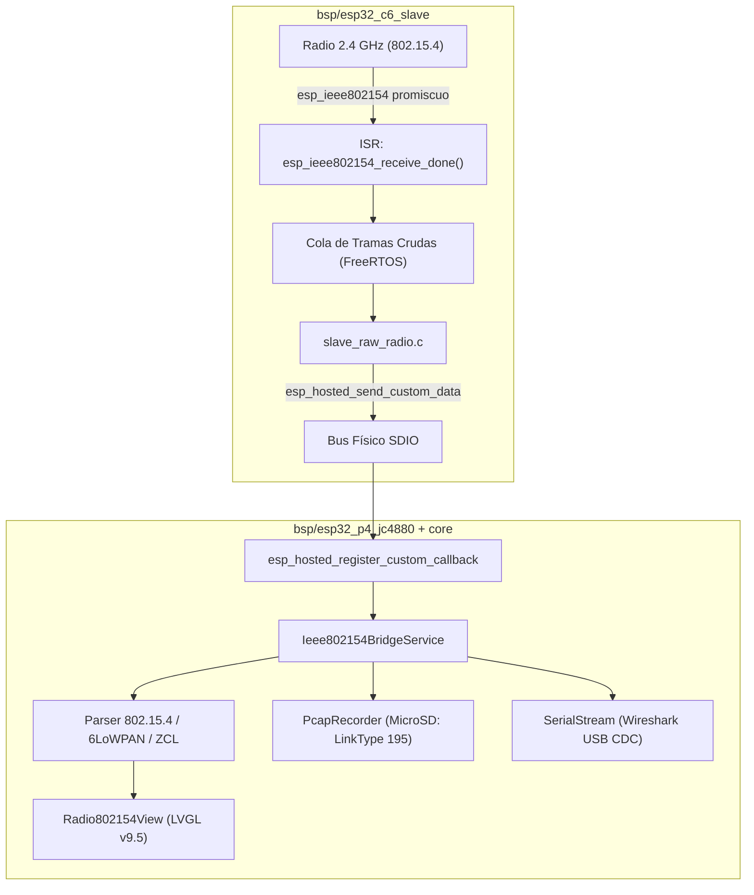
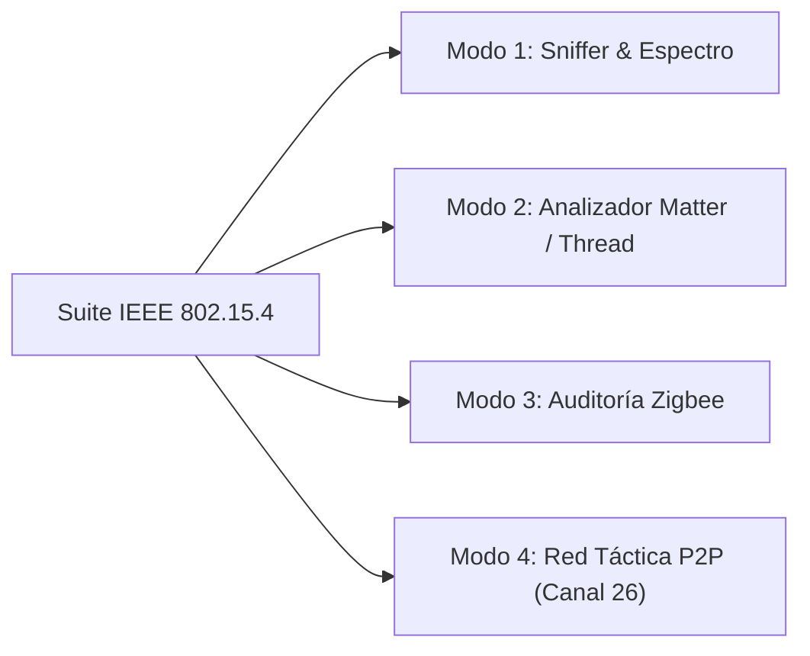

# 📡 Especificación Técnica: Suite Modular IEEE 802.15.4 (Zigbee, Thread, Matter y Radio Cruda P2P)

**Versión:** 1.0.0  
**Fecha:** 15 de Octubre de 2026  
**Estado:** Especificación Técnica Aprobada / En Planificación  
**Categoría:** Arquitectura de Radio / Networking Embebido  
**Plataforma Objetivo:** ESP32-P4 Host (`bsp/esp32_p4_jc4880`) + Coprocesador ESP32-C6 (`bsp/esp32_c6_slave`)  

---

## 🎯 1. Visión y Objetivos

El microcontrolador **ESP32-P4** carece de transceptor inalámbrico integrado en silicio, dependiendo del coprocesador **ESP32-C6** para toda la conectividad de 2.4 GHz. La arquitectura estándar de Espressif (`esp_hosted`) limita este enlace a tráfico de red IP (Wi-Fi) y Bluetooth HCI.

Esta especificación define la arquitectura para **desbloquear y explotar el transceptor IEEE 802.15.4** del ESP32-C6 desde el ESP32-P4 a través del bus de alta velocidad SDIO, transformando a **CBDos** en una estación portátil de análisis, auditoría y comunicación para:
1. **Matter over Thread:** Sniffing, análisis de topología y monitoreo de paquetes domóticos IPv6/6LoWPAN.
2. **Zigbee 3.0 / Pro / ZHA:** Mapeo de redes, detección de dispositivos, captura de handshakes de unión y pruebas de seguridad (Replay, Leave frames).
3. **Monitoreo Promiscuo Universal:** Captura de tráfico en canales 11 a 26 y almacenamiento en MicroSD en formato PCAP estándar (`DLT_IEEE802_15_4`) o streaming USB CDC hacia Wireshark.
4. **Canal Táctico P2P CBDos (Off-Grid):** Enlace de datos privado y silencioso entre Cyberdecks a 250 kbps en el canal 26 (2480 MHz, fuera del espectro Wi-Fi estándar).

---

## 🌐 2. Fundamentos de Radio IEEE 802.15.4 (2.4 GHz)

* **Banda de Frecuencias:** 2405 MHz a 2480 MHz.
* **Canales:** 16 canales asignados (Canales 11 al 26), con separación de 5 MHz entre portadoras.
* **Tasa de Datos:** 250 kbps con modulación O-QPSK y ensanchamiento DSSS.
* **Tamaño Máximo de Trama (PSDU):** 127 bytes (incluyendo CRC/FCS de 2 bytes).
* **El "Canal Silencioso" 26 (2480 MHz):**
  * Los canales Wi-Fi estándar más comunes (1, 6 y 11) cubren hasta ~2473 MHz.
  * El canal 26 de 802.15.4 se encuentra prácticamente libre de la interferencia masiva de routers Wi-Fi domésticos, lo que lo convierte en el canal ideal para operaciones tácticas y enlaces P2P limpios.

---

## 🏗️ 3. Arquitectura del Sistema: Túnel SDIO P4 ⟷ C6

El sistema desacopla estrictamente la captura de radio (en el C6) del procesamiento, almacenamiento y renderizado (en el P4):



### Protocolo de Mensajes Personalizados sobre `esp_hosted`:

| Identificador de Mensaje | Dirección | Descripción / Carga Útil |
| :--- | :---: | :--- |
| `CBDOS_154_CMD_SET_CHANNEL` | P4 ➔ C6 | Fija el canal de escucha (11 a 26). |
| `CBDOS_154_CMD_SET_PROMISC` | P4 ➔ C6 | Activa/Desactiva modo promiscuo en la radio del C6. |
| `CBDOS_154_CMD_START_HOPPING`| P4 ➔ C6 | Inicia salto continuo de canal (11-26 con dwell configurable). |
| `CBDOS_154_EVT_RAW_FRAME` | C6 ➔ P4 | Trama capturada: Cabecera (`rssi`, `channel`, `len`, `timestamp`) + `data[127]`. |
| `CBDOS_154_CMD_INJECT_FRAME` | P4 ➔ C6 | Inyección de trama: Envía paquete crudo en el canal activo. |

---

## 🎛️ 4. Modos de Operación y Funcionalidades



### Modo 1: Sniffer de Espectro y Reconocimiento (Pasivo)
* **Histograma de Actividad:** Gráfica de barras en LVGL v9 que muestra el volumen de paquetes por segundo en cada canal (11 al 26).
* **Descubrimiento de Redes y PAN IDs:** Extracción automática del *Destination PAN ID*, *Source PAN ID* y direcciones MAC cortas (16 bits) o extendidas (EUI-64 de 64 bits).
* **Identificación de Fabricante (OUI):** Resolución automática de fabricantes de domótica a partir de los primeros 3 bytes de la dirección MAC (Philips/Signify, Ikea, Tuya, Aqara/Lumi, Somfy, etc.).
* **Almacenamiento PCAP:** Escritura de buffers en tarjeta MicroSD bajo `/sdcard/pcaps/802154_capture_YYYYMMDD_HHMMSS.pcap` con encapsulación LinkType `195` (`DLT_IEEE802_15_4_WITHFCS`).

### Modo 2: Analizador Matter over Thread
* **Detección de Balizas Thread:** Identificación de redes Thread y enrutadores frontera (*Thread Border Routers*).
* **Descompresión 6LoWPAN (RFC 6282):** Expande las cabeceras comprimidas para revelar direcciones IPv6 de origen/destino y puertos UDP (ej. puerto `5540` para tráfico Matter).
* **Inyección de Clave de Red (Opcional):** Permite al usuario introducir en la UI la *Thread Master Key* (16 bytes) para descifrar en vivo el contenido de las tramas cifradas con AES-CCM-128 y visualizar los eventos de la capa de interacción de Matter.

### Modo 3: Auditoría y Pentesting Zigbee
* **Detección de Replay Vulnerable:** Registro de tramas con contador de secuencia no validado para pruebas de reinyección en bombillas y enchufes compatibles.
* **Captura de Llaves de Enlace (*Transport Key*):** Alarma visual en UI cuando se detecta el handshake de emparejamiento usando la clave pública de la Zigbee Alliance (`ZigBeeAlliance09`: `5A 69 67 42 65 65 41 6C 6C 69 61 6E 63 65 30 39`).
* **Inyección de Tráfico:** Emisión controlada de tramas de prueba (*Beacon Request*, *Network Leave Request*) para auditar la resiliencia de la red.

### Modo 4: Enlace Táctico Privado CBDos P2P
* **Canal Fijo 26 (2480 MHz):** Conexión punto a punto o multipunto entre Cyberdecks CBDos sin depender de routers, torres celulares ni satélites.
* **Velocidad y Eficiencia:** 250 kbps con ACK por hardware y confirmación en microsegundos, ideal para chat cifrado, intercambio de coordenadas GPS y notas de campo.
* **Bajo Consumo:** La radio del C6 permanece en reposo activo entre ráfagas de datos, consumiendo una fracción del consumo de Wi-Fi.

---

## 💻 5. Contratos C++ en el Core (`core/include/cbdos/`)

Para preservar la arquitectura limpia de CBDos, el Core solo interactúa mediante una interfaz agnóstica:

```cpp
namespace cbdos {
namespace radio154 {

enum class Mode {
    Idle,
    PromiscuousSniffer,
    ChannelHopScanner,
    MatterThreadAnalyzer,
    ZigbeeAudit,
    TacticalP2P
};

struct Frame154 {
    uint8_t channel;
    int8_t rssi;
    uint32_t timestamp_us;
    uint8_t length;
    uint8_t payload[127];
};

using FrameCallback = std::function<void(const Frame154& frame)>;

class IIeee802154Backend {
public:
    virtual ~IIeee802154Backend() = default;
    virtual bool startSniffer(uint8_t channel, FrameCallback cb) = 0;
    virtual bool startHopping(FrameCallback cb) = 0;
    virtual bool stop() = 0;
    virtual bool sendRawFrame(uint8_t channel, const uint8_t* data, uint8_t len) = 0;
    virtual bool isAvailable() const = 0;
};

void setBackend(IIeee802154Backend* backend);
IIeee802154Backend* getBackend();

} // namespace radio154
} // namespace cbdos
```

---

## 📅 6. Hoja de Ruta de Implementación

1. **Fase 1 (Coprocesador C6):**
   * Incorporar la inicialización de `esp_ieee802154.h` en `bsp/esp32_c6_slave/main/`.
   * Implementar el despachador de mensajes custom `esp_hosted_send_custom_data()` en el callback ISR.
2. **Fase 2 (Puente Host P4):**
   * Configurar el callback receptor en `bsp/esp32_p4_jc4880/hal/` y canalizarlo a `IIeee802154Backend`.
   * Integrar la grabadora de archivos `.pcap` en la MicroSD con LinkType 195.
3. **Fase 3 (Interfaz de Usuario en LVGL v9.5):**
   * Diseñar la vista `Radio802154View` con gráfico de espectro de canales 11 al 26 y tabla reactiva de dispositivos detectados (PAN ID, MAC, Fabricante, RSSI).
4. **Fase 4 (Capas Superiores Matter & Zigbee):**
   * Añadir parser de cabeceras 6LoWPAN y filtro específico de puerto UDP 5540 para Matter.
   * Añadir detector de claves de transporte para emparejamiento Zigbee.
5. **Fase 5 (Canal Táctico P2P):**
   * Diseñar protocolo de paquetes de chat y telemetría sobre tramas crudas en canal 26.
