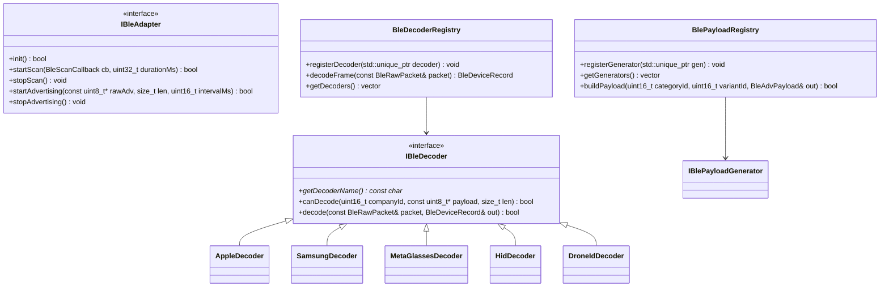

# Especificación Técnica: Suite Modular Wireless Recon, BLE Lab & Analizador de Espectro

**Documento:** `specs/architecture/especificacion_tecnica_suite_modular_ble_air_recon_y_ble_lab.md`  
**Estado:** Propuesta Técnica Aprobada / Lista para Implementación  
**Fecha:** 14 de Octubre de 2026  
**Autor:** Antigravity (Senior Embedded Architecture)  
**Objetivo:** Definir la arquitectura modular, contratos HAL, decodificadores C++ agnósticos, payloads de emisión y diseño de interfaz LVGL 9.5 para la detección nativa (RX) y simulación (TX) de dispositivos Bluetooth LE (Apple, Samsung, Gafas Meta, periféricos HID, Drones), y delimitar el papel del hardware adicional estrictamente como **Analizador de Espectro RF / Waterfall**.

---

## 1. Visión General y Claridad de Arquitectura

### 1.1 Propósito
Dotar a **CBDos** de una suite inalámbrica táctica y defensiva de nivel profesional, dividida de forma limpia y transparente según las capacidades físicas del hardware:

1. **`Air Recon` (Aplicación Nativa de Detección / RX):**
   * **Silicio Nativo de Radio (Bluetooth LE & Wi-Fi):**
     * **Ecosistema Apple:** Detección de AirTags (modo anti-stalking), AirPods (baterías independientes L/R/Case), iBeacons y popups de enlace.
     * **Privacidad y Cámaras:** Detección de gafas inteligentes de grabación (**Ray-Ban Meta / Luxottica** y **Snapchat Spectacles**).
     * **Ecosistema Samsung:** SmartTags, SmartTag2 y Galaxy Buds.
     * **Periféricos de Entrada:** Ratones, teclados y mandos BLE (reconocimiento por Appearance y servicios GATT).
     * **Drones Comerciales:** Decodificación de balizas abiertas ASTM F3411 (Open Drone ID).
     * **Wi-Fi Sniffer:** Rastreo de *Probe Requests* (nombres de redes que buscan los teléfonos cercanos).
   * **Modo Localizador Geiger:** Medidor de proximidad táctil por RSSI con alertas acústicas en el altavoz ES8311.

2. **`BLE Lab` (Aplicación Nativa de Simulación / TX):**
   * Emisión de balizas publicitarias configurables usando el hardware nativo:
     * **AppleJuice:** Popups de vinculación de AirPods, Beats, Apple TV, AirDrop.
     * **SourApple:** Pruebas de estrés y tramas malformadas.
     * **Meta Glasses Spoof:** Simulación de popup de emparejamiento de Ray-Ban Meta.
     * **Google FastPair & Microsoft SwiftPair:** Popups de accesorios en Android y Windows.

3. **`RF Spectrum Analyzer` (Herramienta Visual de Espectro / Waterfall):**
   * Delimitado con total honestidad técnica como **Analizador de Espectro RF** (no como receptor universal).
   * Su función es calcular la FFT y pintar la cascada (*Waterfall*) a 60 FPS en la pantalla táctil para:
     * Inspección visual de canales ocupados y ruidos electromagnéticos.
     * Orientación física y caza de fuentes con antenas direccionales (Yagi / Panel).
     * Visualización de saltos de frecuencia (*frequency hopping*) de mandos o drones.

---

## 2. Taxonomía de Ecosistemas y Firmas Decodificables

### 2.1 Dispositivos de Grabación y Gafas Inteligentes (Privacidad)
| Dispositivo | Company ID (CID) / UUID | Tipo de Detección | Comportamiento / Alerta |
| :--- | :--- | :--- | :--- |
| **Ray-Ban Meta (Stories / Gen 2)** | `0x058A` (Meta Platforms) / `0x08F5` (Luxottica) | Manufacturer Specific Data + Service `0xFDF7` (Meta View) | Alerta visual de cámara cercana. Muestra RSSI y nivel de enlace. |
| **Snapchat Spectacles** | `0x0181` (Snap Inc.) | Manufacturer Specific Data con prefijo de vinculación Spectacles | Clasificación como "Smart Glasses / Cámara". |
| **Cámaras Corporales / ALPR** | OUIs/CIDs según `sigdb_surveillance` | Coincidencia de prefijos BLE + Wi-Fi probe | Alerta de centinela pasivo. |

### 2.2 Ecosistema Apple (Continuity & Find My)
* **Company Identifier:** `0x004C` (Apple, Inc.)
* **Sub-tipos:**
  * `0x12` - **Find My / AirTag:** Baliza de localización offline. Clave pública rotativa (28 bytes) y status byte.
  * `0x07` - **Proximity Pairing (AirPods / Beats):** Estado de batería de auricular izquierdo, derecho y estuche de carga en tiempo real.
  * `0x10` - **Nearby Action:** Popups de configuración de Apple TV, transferencias de audio HomePod, compartir contraseñas Wi-Fi.
  * `0x05` - **AirDrop:** Detección de presencia AirDrop activa.
  * `0x02` - **iBeacon:** UUID de 16 bytes, Major, Minor, TX Calibrado.

### 2.3 Ecosistema Samsung (SmartThings & Galaxy Buds)
* **Company Identifier:** `0x0075` (Samsung Electronics)
* **Sub-tipos:**
  * `0x42` / `0x09` - **SmartThings Find (SmartTag / SmartTag2):** Balizas de rastreo offline con Service Data `0xFD5A`.
  * `0x01` - **Galaxy Buds:** Auriculares Samsung y solicitud de conexión.

### 2.4 Ecosistema Google / Android
* **Service UUID:** `0xFE2C` (**Google Fast Pair Service - GFPS**)
* **Identificación:** Accesorios Android (Pixel Buds, altavoces, relojes Wear OS).

### 2.5 Ecosistema Microsoft Windows
* **Company Identifier:** `0x0006` (Microsoft)
* **Sub-tipo `0x03`:** **Microsoft Swift Pair:** Anuncios de emparejamiento rápido para Windows 10/11.

### 2.6 Periféricos Estándar de Entrada (HID)
* **Appearance (GAP Data Type `0x19`):**
  * `0x03C0` - Generic HID | `0x03C1` - Keyboard | `0x03C2` - Mouse | `0x03C4` - Gamepad
* **Service UUIDs:** `0x1812` (HID Service), `0x180F` (Battery Service).

### 2.7 Drones Comerciales (ASTM F3411 Remote ID)
* **Open Drone ID:** Mensajes de identificación básica, localización, vector de vuelo (latitud, longitud, altitud, velocidad) y posición del piloto en tierra transmitidos en anuncios BLE.

---

## 3. Arquitectura del Software (Core C++)



### 3.1 Estructuras de Datos (`core/include/cbdos/radio/ble_types.hpp`)

```cpp
#pragma once
#include <cstdint>
#include <string>
#include <vector>

namespace cbdos {
namespace radio {

enum class BleDeviceCategory : uint8_t {
    Unknown = 0,
    AppleAirTag,
    AppleAirPods,
    AppleDevice,
    SamsungSmartTag,
    SamsungDevice,
    MetaSmartGlasses,
    PeriperalMouse,
    PeripheralKeyboard,
    PeripheralGamepad,
    AndroidFastPair,
    WindowsSwiftPair,
    DroneRemoteId,
    SurveillanceCamera
};

struct BleRawPacket {
    uint8_t mac[6];
    int8_t rssi;
    uint8_t advData[62];
    size_t advLen;
    uint32_t timestampMs;
};

struct BleDeviceRecord {
    uint8_t mac[6];
    std::string macStr;
    std::string name;
    std::string vendor;
    std::string details;
    BleDeviceCategory category = BleDeviceCategory::Unknown;
    int8_t rssi = -100;
    int8_t txPower = 0;
    uint8_t batteryPercent = 0xFF; // 0xFF = Desconocido
    bool hasBattery = false;
    bool isTracker = false;
    bool isCameraDevice = false;
    uint32_t firstSeenMs = 0;
    uint32_t lastSeenMs = 0;
    uint32_t hitCount = 0;
};

struct BlePayloadVariant {
    uint16_t id;
    std::string name;
    std::string description;
};

struct BleAdvPayload {
    uint8_t data[31];
    size_t len;
    bool randomMac;
};

} // namespace radio
} // namespace cbdos
```

---

## 4. Diseño de Interfaz de Usuario (LVGL 9.5 Estricto)

### 4.1 Aplicación `Air Recon` (`AirReconView`)
Derivada de `BaseView`, organizada con filtros táctiles rápidos:

```
+-------------------------------------------------------------+
| HeaderBar: [<-]  AIR RECON (48 Dispositivos)        [100%] |
+-------------------------------------------------------------+
| [Todos] [🍏 Apple] [🪐 Samsung] [👓 Gafas Meta] [🖱️ HID] [🚁 Drones] |
+-------------------------------------------------------------+
| ------------------- LISTA TÁCTIL (SCROLL) ------------------|
| [👓] Ray-Ban Meta (Gafas Cámara)         RSSI: -56 dBm  |||  |
|      MAC: 4A:22:98:B1:0E:54 | Privacidad: Cámara Activa     |
|                                         [📍 Localizar / Geiger]|
|-------------------------------------------------------------|
| [🍏] Apple AirTag (Find My)              RSSI: -64 dBm  |||  |
|      Clave Rotativa | Estado: No emparejado (Separado)      |
|                                         [📍 Localizar / Geiger]|
|-------------------------------------------------------------|
| [🍏] AirPods Pro (2nd Gen)               RSSI: -42 dBm ||||  |
|      Batería: L: 90% | R: 85% | Case: 100%                 |
|-------------------------------------------------------------|
| [🖱️] Logitech MX Master 3                RSSI: -58 dBm  |||  |
|      Tipo: Ratón Inalámbrico BLE | Bat: 80%                 |
+-------------------------------------------------------------+
| Botones Inferiores:  [ PAUSAR ESCANEO ]     [ LIMPIAR LISTA ]|
+-------------------------------------------------------------+
```

#### Modal "Radar / Geiger RSSI" (`BleGeigerModal`):
* Círculo de proximidad animado en LVGL 9.5.
* **Sonido Contador Geiger reactivo (ES8311):** Emite "clicks" acústicos cuya frecuencia se acelera a medida que el usuario se acerca físicamente al objeto escondido (AirTag, gafas, baliza).

---

### 4.2 Aplicación `BLE Lab` (`BleLabView`)
La interfaz de emisión táctica:

```
+-------------------------------------------------------------+
| HeaderBar: [<-]  BLE LAB (TRANSMISOR)               [100%] |
+-------------------------------------------------------------+
| Categoría:  [ 🍏 AppleJuice                         v ]     |
| Payload:    [ AirPods Pro (Popup de Vinculación)     v ]     |
+-------------------------------------------------------------+
| Parámetros de Transmisión:                                  |
|   • Potencia TX: [ +20 dBm (Máxima) ]                       |
|   • Intervalo:   [ 100 ms           ]                       |
|   • MAC Rotativa: [x] Activada (Evita deduplicación)        |
+-------------------------------------------------------------+
| Estado: TRANSMISIÓN ACTIVA...                               |
| Paquetes emitidos: 1,428 tramas                             |
| [======================== CARGANDO / EN VIVO ==============]|
+-------------------------------------------------------------+
|             [ 🛑 DETENER TRANSMISIÓN ]                      |
+-------------------------------------------------------------+
```

---

## 5. Abstracción HAL y Soporte Multi-Target

### 5.1 ESP32-S3 (`bsp/esp32_s3_jc3248/`)
* Implementación nativa sobre el stack Bluetooth LE del S3 (usando las APIs optimizadas de `host/ble_gap.h` de NimBLE / ESP-IDF).
* Tarea FreeRTOS dedicada `bleScannerTask` anclada en Core 0 para garantizar cero interrupciones en la tasa de refresco a 60 FPS en Core 1.

### 5.2 ESP32-P4 (`bsp/esp32_p4_jc4880/`)
* El SoC ESP32-P4 no cuenta con radio RF 2.4 GHz en su silicio principal.
* La interfaz `IBleAdapter` permite compilar limpiamente:
  * Si hay una mochila o companion ESP32-S3 conectado por USB CDC o UART, la implementación HAL enruta los eventos procesados.
  * Si no hay módulo radio presente, la interfaz reporta `isAvailable() == false`, deshabilitando ordenadamente las funciones en la UI sin colapsar el sistema.

---

## 6. Plan de Implementación por Fases

### Fase 1: Núcleo de Tipos y Registros Agnósticos en `core/`
* Crear `core/include/cbdos/radio/ble_types.hpp`.
* Crear interfaces `IBleDecoder.hpp` y `IBlePayloadGenerator.hpp`.
* Implementar `BleDecoderRegistry` y `BlePayloadRegistry`.
* Integrar los decodificadores y generadores:
  * `AppleDecoder` (AirTags, AirPods, Continuity).
  * `MetaGlassesDecoder` (Ray-Ban Meta, Luxottica, Spectacles).
  * `SamsungDecoder` (SmartTags, Galaxy Buds).
  * `HidDecoder` (Mouses, Teclados).
  * `DroneIdDecoder` (ASTM F3411 Remote ID).
  * `AppleJuicePayloads`, `SourApplePayloads`, `MetaSpoofPayloads`, `FastPairPayloads`.

### Fase 2: HAL BLE Reactivo en BSP S3
* Implementar `hal_ble_s3.cpp` en `bsp/esp32_s3_jc3248/hal/` implementando la interfaz `IBleAdapter`.
* Configurar callbacks asíncronos y colas FreeRTOS protegidas por mutex para entrega de tramas.

### Fase 3: Vistas Táctiles en LVGL 9.5
* Crear `core/src/ui/views/AirReconView.hpp/.cpp` con chips de filtrado táctil y lista dinámica.
* Crear `core/src/ui/views/BleLabView.hpp/.cpp` con selector de payloads y control de emisión.
* Crear modal táctil `BleGeigerModal` con retroalimentación sonora ES8311.

### Fase 4: Registro en el Sistema y Perfiles
* Añadir `CBDOS_FEATURE_AIR_RECON` y `CBDOS_FEATURE_BLE_LAB` a `cbdos_build_profile.h`.
* Registrar las aplicaciones en `AppRegistry.cpp`.
* Validar compilación limpia dual en ESP32-S3 y ESP32-P4.
