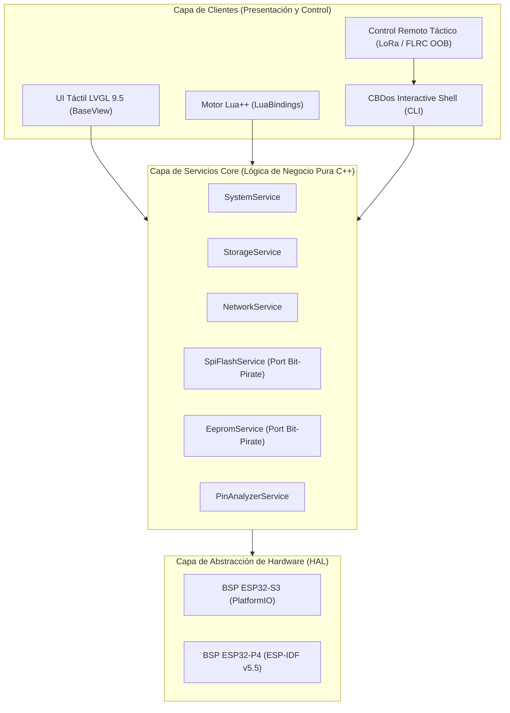

# Especificación de Arquitectura: Unificación de Servicios Core y Desacoplamiento de la Shell (CBDos Shell & Core Services)

- **Fecha:** 2026-10-23
- **Estado:** Planificado / En Especificación
- **Ubicación:** `specs/architecture/especificacion_unificacion_servicios_core_y_desacoplamiento_shell.md`
- **Ámbito:** `core/src/system/`, `core/src/lua/bindings/`, `core/src/services/`, `core/src/terminal/`

---

## 1. Contexto y Diagnóstico Arquitectónico

Durante la evolución rápida de CBDos, la arquitectura por capas original definida en `specs/drafts/arquitectura_cbdos_forma_y_estructura.md` sufrió dispersión:

```
[Visión Original]
UI / Apps / Terminal / Lua  -->  Core Services (Lógica Pura C++)  -->  HAL / Drivers (S3 / P4)
```

**La Realidad Actual:**
1. **Duplicación de Lógica entre Lua y Shell:**
   - Los bindings de Lua (`core/src/lua/bindings/LuaBindings_*.cpp`) implementan lógica de hardware y consultas directas al HAL/BSP de forma aislada.
   - La shell de sistema (`core/src/system/system_cli.cpp`) reimplementa sus propios parsers y formateadores de texto sin compartir modelo de datos con Lua.
2. **Ausencia de una Capa de Servicios C++ Formal:**
   - La lógica de negocio está dividida en llamadas globales dispersas en `cbdos::system::*`, `cbdos::wifi::*` o `cbdos::storage::*`.
3. **Pérdida de Potencial para Extensiones:**
   - Dificulta integrar herramientas de bajo nivel de repositorios de referencia (como el flasheador SPI Flash y EEPROM de `ESP32-Bit-Pirate`).
   - Complica exponer el control remoto por canales físicos (LoRa / FLRC SX1280).

---

## 2. Principio Rector: "Cero Lógica en los Clientes"

La arquitectura se reorganiza formalmente en **3 niveles estrictos**:



### Reglas de Diseño:
1. **Los Bindings de Lua NO tocan el HAL ni implementan lógica:**
   - Cada binding en `LuaBindings_*.cpp` debe ser un *wrapper* fino de 3 a 5 líneas que llama al método correspondiente del `Service` y convierte el resultado a la pila de Lua.
2. **La Shell de CBDos NO implementa lógica:**
   - Cada comando en la Shell recibe argumentos en texto, invoca al método del `Service` y muestra el resultado formateado por el flujo de salida (`ITerminalView` / callback de texto).
3. **Los Servicios NO dependen de strings ni de Lua ni de LVGL:**
   - Un `Service` opera con estructuras C++ puras (`struct`, `std::vector`, `uint32_t`, `enums`).

---

## 3. Arquitectura de la Shell Desacoplada (`cbdos::cli`)

Inspirado en la robustez y modularidad de `ESP32-Bit-Pirate`, la Shell adopta el patrón de **Sub-Consolas Contextuales** y **Transporte Agnóstico**:

### 3.1. Transporte Agnóstico (Flujos de Entrada / Salida)
La Shell no asume que la entrada viene de un cable USB ni que la salida va a una pantalla física:
* **Entrada (`IInputStream`):**
  - Serial CDC USB (`/dev/ttyACM0`).
  - Terminal interna gráfica LVGL (`libvterm` / pantalla táctil).
  - Trama entrante encriptada por radio **LoRa** o **FLRC (SX1280)**.
  - Script batch desde tarjeta MicroSD.
* **Salida (`IOutputStream`):**
  - Respuesta hacia el canal que emitió la orden.

### 3.2. Sub-Consolas Contextuales (Evitar el Monolito de Comandos)
En lugar de una lista plana desbordada de comandos, la shell implementa contextos de ejecución:

| Contexto / Shell | Prompt | Comandos Habilitados |
| :--- | :--- | :--- |
| **Root Shell** | `CBDOS >` | `status`, `top`, `reboot`, `lua <file>`, `mount`, `flash`, `eeprom`, `pinout`, `wifi`, `help` |
| **SPI Flash Shell** | `CBDOS [spi-flash] >` | `id`, `read <addr> <len>`, `dump <file>`, `write <file> [addr]`, `erase [sector|chip]`, `verify`, `exit` |
| **EEPROM I2C Shell** | `CBDOS [i2c-eeprom] >`| `detect`, `read <addr> <len>`, `dump <file>`, `write <file>`, `erase`, `exit` |
| **Pinout Hunter** | `CBDOS [pinout] >` | `scan <pin_list>`, `uart`, `i2c`, `jtag`, `exit` |
| **Tactical Radio** | `CBDOS [radio-oob] >` | `flrc ping`, `lora tx <msg>`, `listen`, `exit` |

---

## 4. Fases de Ejecución

### Fase 1: Extracción y Formalización de Servicios Core Base
- [ ] Mover/centralizar funciones de `system_cli.cpp` y `LuaBindings_System.cpp` hacia un `SystemService` unificado en `core/src/system/`.
- [ ] Adaptar `LuaBindings_System.cpp` para que consuma exclusivamente `SystemService`.
- [ ] Dejar la Shell base operando sobre este servicio.

### Fase 2: Modularización del Motor de Comandos y Sub-Shells
- [ ] Diseñar el despachador contextual (`CommandContext`, `SubShell`).
- [ ] Separar los comandos en archivos específicos (`core/src/terminal/shells/`) en lugar de mantener un único archivo gigante `system_cli.cpp`.

### Fase 3: Integración de Módulos de Hardware Hacking (`ESP32-Bit-Pirate`)
- [ ] Portar `FlashDatabase.h` y la lógica de `SpiService.cpp` a un servicio C++ nativo `core/src/hardware/SpiFlashService.cpp`.
- [ ] Crear la sub-consola `SpiFlashShell`.
- [ ] Exponer los bindings correspondientes en `cbdos.spi.*` para Lua++.
- [ ] Repetir el proceso para el servicio de memorias EEPROM I2C (`24Cxx`).

### Fase 4: Enlace Táctico Fuera de Banda (Radio OOB Control)
- [ ] Conectar el receptor de paquetes LoRa / FLRC con la entrada de la Shell de CBDos con verificación de autenticación/firma criptográfica.
