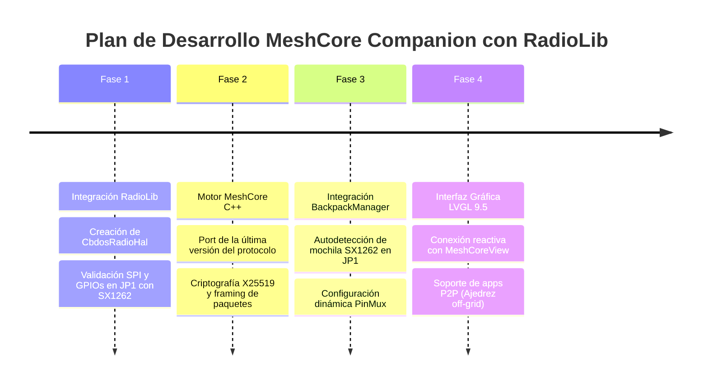

# 📡 Especificación de Arquitectura: MeshCore Companion, RadioLib y Mochilas Modulares JP1

**Documento:** `specs/architecture/plan_meshcore_companion_radiolib_y_mochilas_jp1.md`  
**Fecha:** 2026-10-15  
**Estado:** Aprobado / En Planificación  
**Target:** ESP32-P4 (JC4880) & ESP32-S3 (JC3248)  
**Módulos Afectados:** `core/src/meshcore/*`, `core/include/cbdos/meshcore/*`, `core/src/radio/*`, `core/include/cbdos/gpio.hpp`, `core/src/ui/views/MeshCoreView.*`

---

## 🎯 1. Visión General y Justificación Técnica

Esta especificación formaliza la implementación del cliente **MeshCore (rol Companion)** en **CBDos**, diseñado para operar de forma modular mediante **mochilas de radio físicas (Backpacks)** conectadas a la cabecera de expansión **JP1** o mediante **USB Host**.

### 1.1. Por qué el rol Companion y no Repetidor
* **Terminal Autónomo de Usuario:** CBDos opera como una estación de usuario (mensajería, canales grupales, telemetría y aplicaciones P2P como ajedrez off-grid).
* **Eficiencia de Batería y CPU:** Un nodo repetidor de infraestructura (como los nodos dedicados Heltec/RAK en mástiles o tejados) requiere escucha continua 24/7 y gestión de retransmisión masiva. El rol Companion actúa como cliente final (`non-repeating`), transmitiendo y recibiendo únicamente el tráfico de interés para el dispositivo sin degradar la batería ni saturar la CPU que ejecuta LVGL 9.5.

### 1.2. Decisión Arquitectónica: Rechazo de Implementaciones Legacy (GhostESP)
GhostESP implementó MeshCore en C procedural monolítico atado a una versión antigua de upstream (**v1.17.1**), con pines de radio fijos en código.  
**CBDos adopta la especificación más reciente de MeshCore** implementada limpiamente en C++ moderno, evitando deuda técnica, estructuras obsoletas de paquetes o incompatibilidad con la red actual.

### 1.3. Integración de RadioLib como Abstracción de RF
En lugar de programar registros SPI a bajo nivel o reescribir drivers para lidiar con las complejidades del transceptor Semtech **SX1262** (calibración de oscilador TCXO, regulador DC-DC, líneas BUSY y DIO1), se adopta **RadioLib** en la capa física de radio por las siguientes razones:
1. **Robusto y Probado en Producción:** Estándar de la industria en proyectos como Meshtastic.
2. **C++ Nativo:** Se acopla de forma natural a la arquitectura orientada a objetos de `core/`.
3. **Multi-Transceptor:** Habilita el soporte futuro para otras mochilas (CC1101 en Sub-GHz, SX1280 en 2.4 GHz) reutilizando la misma arquitectura.

---

## 🏗️ 2. Arquitectura de Capas en CBDos

```
┌────────────────────────────────────────────────────────────────────────┐
│                        Capa de Presentación                            │
│           MeshCoreView (LVGL v9.5 / BaseView / HeaderBar)              │
│       - Chats directos, canales de grupo, lista de contactos           │
│       - Reactivo: Cero polling (notificación por callbacks/flags)      │
└───────────────────────────────────┬────────────────────────────────────┘
                                    │
┌───────────────────────────────────▼────────────────────────────────────┐
│                       Capa de Protocolo y Red                          │
│          MeshCoreClient (Última Especificación de MeshCore)            │
│       - Formateo de tramas, framing binario y enrutamiento             │
│       - Criptografía de clave pública X25519 y anuncios de presencia   │
│       - Despacho de paquetes (Chat ID 0x00, Apps binarias ID 0x10)     │
└───────────────────────────────────┬────────────────────────────────────┘
                                    │ Paquetes binarios
┌───────────────────────────────────▼────────────────────────────────────┐
│                    Capa de Abstracción de Radio                        │
│                 RadioLib (Clase SX1262 / C++)                          │
│       - Modulación LoRa, potencia TX, frecuencia, ancho de banda, SF   │
│       - Máquina de estados de transmisión/recepción e interrupciones   │
└───────────────────────────────────┬────────────────────────────────────┘
                                    │ Llama a la HAL virtual
┌───────────────────────────────────▼────────────────────────────────────┐
│                           CbdosRadioHal                                │
│       - Implementación concreta de RadioLibHal                         │
│       - Consulta a GpioManager y BackpackManager para el mapeo         │
└───────────────────────────────────┬────────────────────────────────────┘
                                    │
┌───────────────────────────────────▼────────────────────────────────────┐
│                     Hardware Físico / Mochilas                         │
│   ┌───────────────────────────────┐  ┌─────────────────────────────┐   │
│   │   Mochila Pasiva JP1 (SPI)    │  │  Mochila Inteligente (USB)  │   │
│   │   • SX1262 directo a JP1      │  │  • Dongle LoRa USB Host CDC │   │
│   │   • Pines asignados en vivo   │  │  • Fallback serie           │   │
│   └───────────────────────────────┘  └─────────────────────────────┘   │
└────────────────────────────────────────────────────────────────────────┘
```

---

## 🔌 3. Interfaz de Hardware: Cabecera JP1 y `CbdosRadioHal`

### 3.1. Mapeo Dinámico mediante `GpioManager`
La cabecera de expansión **JP1** no tiene pines congelados a una sola función. Cuando se acopla una mochila LoRa SX1262, el **GpioManager** configura las líneas necesarias:

| Señal SX1262 | Rol en JP1 | Función |
| :--- | :--- | :--- |
| **SCK** | SPI Clock | Reloj de sincronización SPI |
| **MISO** | SPI Data In | Datos del transceptor a la CPU |
| **MOSI** | SPI Data Out | Configuración y carga de paquetes |
| **NSS / CS** | Chip Select | Habilitación de chip (activo en bajo) |
| **BUSY** | Control de Estado | Señal de estado ocupado del SX1262 |
| **DIO1** | Interrupción RF | Señal de fin de TX / paquete recibido (RX) |
| **RST** | Reset Hardware | Línea de reinicio del transceptor |
| **RF_SW** | Switch de Antena | Control de conmutador RF (si la mochila lo requiere) |

### 3.2. Implementación de `CbdosRadioHal`
RadioLib proporciona la interfaz virtual pura `RadioLibHal`. En CBDos se implementa como puente hacia nuestro sistema:

```cpp
#pragma once
#include <RadioLib.h>
#include "cbdos/gpio.hpp"

namespace cbdos {
namespace radio {

class CbdosRadioHal : public RadioLibHal {
public:
    CbdosRadioHal();
    virtual ~CbdosRadioHal() = default;

    // Inicialización y configuración de pines según GpioManager
    void init() override;
    void term() override;

    // Métodos GPIO abstractos consumidos por RadioLib
    void pinMode(uint32_t pin, uint32_t mode) override;
    void digitalWrite(uint32_t pin, uint32_t value) override;
    uint32_t digitalRead(uint32_t pin) override;

    // Bus SPI gobernado por el BSP
    void spiBegin() override;
    void spiEnd() override;
    void spiTransfer(uint8_t* out, size_t len, uint8_t* in) override;

    // Temporización cooperativa con FreeRTOS
    void delay(unsigned long ms) override;
    void delayMicroseconds(unsigned long us) override;
    unsigned long millis() override;
    unsigned long micros() override;

    void yield() override;
};

} // namespace radio
} // namespace cbdos
```

---

## 📦 4. Modelo de Transmisión y Soporte de Mochilas

El sistema admite dos métodos de operación de acuerdo a la mochila conectada:

### Modo 1: Mochila Pasiva Directa (Cabecera JP1) - Recomendado
* El SX1262 está conectado directamente a los pines SPI/GPIO de la cabecera JP1.
* `CbdosRadioHal` toma el control de los pines vía `GpioManager`.
* RadioLib ejecuta el control de radio directamente desde el firmware de CBDos en el ESP32-P4 o ESP32-S3.
* **Ventaja:** Menor coste de hardware en la mochila, latencia mínima y cero dependencias de coprocesadores externos.

### Modo 2: Mochila Inteligente / Dongle USB Host (Fallback)
* El módulo de radio cuenta con su propio microcontrolador y firmware de radio autónomo.
* Se conecta por el puerto USB-C Host (reconocido por `UsbDeviceManager` como CDC-ACM) o por el puerto serie JP1.
* La capa `MeshCoreClient` envía y recibe los paquetes formateados mediante la API [`cbdos::serial`](file:///home/kaber420/Documentos/proyectos/cbdos/core/include/cbdos/serial.hpp).
* **Ventaja:** Compatibilidad con radios comerciales ya montadas (como dongles Heltec/T-Beam USB).

---

## 📋 5. Fases de Implementación



1. **Fase 1 — Abstracción de Radio:**
   * Agregar RadioLib como componente gestionado o submodule en `core/src/radio/`.
   * Implementar `CbdosRadioHal.cpp` conectándolo al bus SPI del BSP y las APIs de `cbdos::gpio`.
   * Test básico de inicialización (`radio.begin()`) y lectura del registro chip ID del SX1262 (`0x142`).

2. **Fase 2 — Protocolo MeshCore Moderno:**
   * Implementar `MeshCoreEngine` en C++ bajo `core/src/meshcore/` basado en la especificación más reciente del protocolo.
   * Manejo de identidades, almacenamiento en NVS/LittleFS de contactos y claves, y colas de entrada/salida.

3. **Fase 3 — Integración con BackpackManager:**
   * Registro del descriptor de hardware para la mochila LoRa SX1262 en el sistema de mochilas de JP1.
   * Inicialización bajo demanda: si la mochila no está presente, el módulo permanece inactivo y consume 0 bytes de buffers de radio.

4. **Fase 4 — Interfaz Gráfica y Aplicaciones:**
   * Conectar callbacks reactivos hacia `MeshCoreView` para actualización de chats y métricas de señal (RSSI, SNR).
   * Habilitar el canal de multiplexación de datos para que scripts en Lua o juegos en C++ (Ajedrez) puedan enviar paquetes por la malla.
