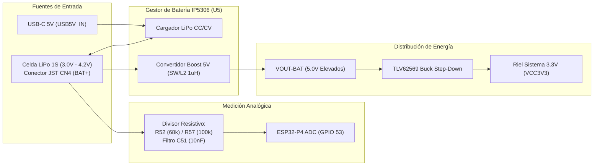

# 🔋 Especificación Técnica: Medición Real de Batería (IP5306 + Divisor ADC) e Integración en HeaderBar

* **Estado:** 📝 Especificación Oficial de Hardware e Integración UI  
* **Fecha:** 2026-10-21  
* **Target Primario:** Guition JC4880P443C (ESP32-P4)  
* **Subsistema:** Gestión de Energía (PMU) & Interfaz de Usuario (LVGL v9.5)  
* **Fuente de la Verdad Esquemática:** `specs/hardware/schematics/1_PWR.png` y `specs/hardware/schematics/4_USB&IO.png`

---

## ⚡ 1. Topología del Hardware de Alimentación

El subsistema de potencia de la placa Guition JC4880P443C opera con una arquitectura de **batería externa integrada** mediante el CI **Injoinic IP5306** (`U5` en `1_PWR.png`):



### 1.1. Componentes Físicos del Divisor Analógico (`4_USB&IO.png`)
* **Punto de Toma:** Directamente en la pista **`BAT+`** (bornes químicos de la celda de litio), **NO** en el riel elevado de 5V `VOUT-BAT`.
* **Resistor Superior ($R_{top}$):** `R52 = 68 kΩ` (tolerancia 1%).
* **Resistor Inferior ($R_{bottom}$):** `R57 = 100 kΩ` (tolerancia 1%).
* **Filtro de Ruido:** `C51 = 10 nF` en paralelo con $R57$.
* **Puente de Acoplo:** `R55 = 0 Ω`.
* **Pin de Lectura SoC:** **`GPIO 53`** del ESP32-P4 (`BAT_ADC`, canal ADC1).

---

## 📐 2. Ecuaciones y Curva de Calibración

### 2.1. Factor de Escala Analógico
La tensión que llega al convertidor ADC del ESP32-P4 ($V_{ADC}$) responde a la ecuación de divisor de tensión:

$$V_{ADC} = V_{BAT} \times \left( \frac{R57}{R52 + R57} \right) = V_{BAT} \times \left( \frac{100\,\text{k}\Omega}{68\,\text{k}\Omega + 100\,\text{k}\Omega} \right) = V_{BAT} \times \frac{100}{168} \approx V_{BAT} \times 0.59524$$

Para obtener el voltaje real de la batería desde la muestra en milivoltios leída por el ADC:

$$V_{BAT} = V_{ADC} \times \frac{168}{100} = V_{ADC} \times 1.68$$

### 2.2. Tabla de Mapeo de Voltaje a Porcentaje (1S LiPo / Li-Ion)

| Estado de Carga | Tensión Batería ($V_{BAT}$) | Tensión en Pin ADC ($V_{ADC}$) | Porcentaje Reportado | Icono LVGL |
| :---: | :---: | :---: | :---: | :---: |
| **Carga Máxima (Full)** | $\ge 4.18\text{ V}$ | $\ge 2.488\text{ V}$ | **100%** | `LV_SYMBOL_BATTERY_FULL` |
| **Alta** | $4.00\text{ V}$ | $2.381\text{ V}$ | **80%** | `LV_SYMBOL_BATTERY_FULL` |
| **Media-Alta** | $3.85\text{ V}$ | $2.292\text{ V}$ | **60%** | `LV_SYMBOL_BATTERY_3` |
| **Media-Baja (Nominal)**| $3.70\text{ V}$ | $2.202\text{ V}$ | **40%** | `LV_SYMBOL_BATTERY_2` |
| **Baja** | $3.55\text{ V}$ | $2.113\text{ V}$ | **20%** | `LV_SYMBOL_BATTERY_1` |
| **Crítica (Alerta)** | $3.40\text{ V}$ | $2.024\text{ V}$ | **5%** | `LV_SYMBOL_BATTERY_EMPTY` (Rojo) |
| **Corte UVLO (Apagado)**| $\le 3.30\text{ V}$ | $\le 1.964\text{ V}$ | **0%** | `LV_SYMBOL_BATTERY_EMPTY` |

---

## 🔍 3. Comportamientos Críticos del IP5306 y Filtrado de Software

El comportamiento del cargador IP5306 introduce dos estados que el software debe interpretar para evitar lecturas erróneas:

1. **Estado Conectado a USB (Cargando):**
   * El IP5306 inyecta corriente constante/voltaje constante hacia `BAT+`. El voltaje sube a ~4.20V independientemente de la carga previa de la batería.
   * *Lógica de software:* Si $V_{BAT} \ge 4.22\text{ V}$ o se detecta presencia de VBUS USB, el sistema reporta estado **Cargando** y activa el símbolo `LV_SYMBOL_CHARGE`.
2. **Estado Sin Batería (Solo USB Conectado):**
   * El pin `BAT` queda flotante en el conector JST. El IP5306 oscila en pulsos de búsqueda de celda.
   * *Lógica de software:* Detección de fluctuaciones anómalas sin carga para marcar `BATT: N/A` o icono de cable directo.
3. **Estado Autónomo en Campo (Solo Batería):**
   * La celda alimenta el conversor Boost. El voltaje en `BAT+` disminuye progresivamente según la impedancia interna y la descarga real. **En este estado la lectura es 100% precisa y fidedigna.**

---

## 🖥️ 4. Plan de Integración en el Sistema

### 4.1. Capa HAL: Driver ADC One-Shot (`hal_system_p4.cpp`)
* Utilizar la API oficial de ESP-IDF v5.3:
  * `adc_oneshot_new_unit()` en `ADC_UNIT_1`.
  * `adc_oneshot_config_channel()` con atenuación `ADC_ATTEN_DB_12` (permite lecturas de hasta 3.3V).
  * `adc_cali_create_scheme_curve_fitting()` para calibración con compensación de eFuse.
* Implementar:
  ```cpp
  namespace cbdos {
  namespace system {
      float getBatteryVoltage();      // Retorna voltaje en Voltios (ej. 3.84f)
      uint8_t getBatteryPercent();     // Retorna 0 a 100 (o 255 si no hay bateria)
      bool isBatteryCharging();       // Retorna true si VBUS está activo y V >= 4.18V
  }
  }
  ```

### 4.2. Capa UI: HeaderBar (`HeaderBar.hpp` / `HeaderBar.cpp`)
* Añadir `m_labelBattery` dentro de `rightBox`, posicionado a la izquierda de `m_labelWifi`:
  ```text
  ┌────────────────────────────────────────────────────────┐
  │ [ < Volver ]            Título            [ 🔋 85% ] [📶] │
  └────────────────────────────────────────────────────────┘
  ```
* **Comportamiento Reactivo:**
  * Actualización periódica en `timerCallback()` (cada 5 a 10 segundos para no despertar ciclos de CPU innecesarios).
  * Iconografía dinámica según umbrales de la tabla 2.2.
  * Si está cargando: color de acento primario + `LV_SYMBOL_CHARGE`.
  * Si la batería es $< 15\%$: color rojo de advertencia `0xFF3333`.

### 4.3. Capa Lua: Puente Real (`LuaBindings_System.cpp`)
* Reemplazar el retorno falso `lua_pushinteger(L, 100)` por la llamada directa al HAL:
  ```cpp
  static int lua_get_battery(lua_State* L) {
      lua_pushinteger(L, (lua_Integer)cbdos::system::getBatteryPercent());
      return 1;
  }
  ```
