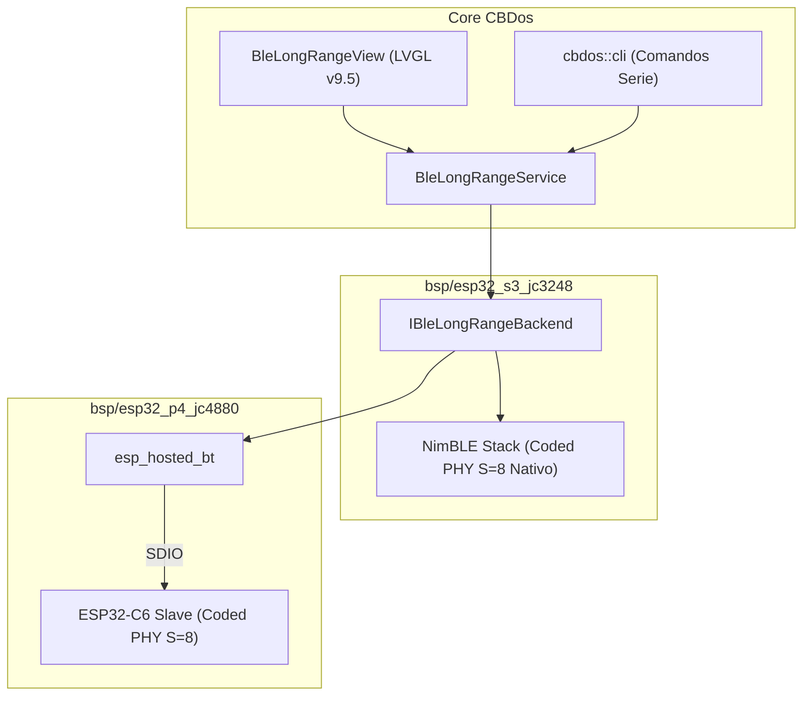

# 📡 Propuesta Técnica: Enlace Táctico de Larga Distancia vía BLE Coded PHY (1 MHz @ 125 kbps)

**Fecha:** 15 de Octubre de 2026  
**Estado:** Propuesta Técnica / Lista para Pruebas de Campo  
**Categoría:** Networking Embebido / Radiofrecuencia de Bajo Consumo  
**Hardware Compatible:** ESP32-S3 (`bsp/esp32_s3_jc3248`) y ESP32-C6 Coprocesador en P4 (`bsp/esp32_c6_slave`)  

---

## 🎯 1. Resumen Ejecutivo

Frente a los canales anchos y saturados de Wi-Fi (20 a 40 MHz) y las limitaciones de 802.15.4, la especificación **Bluetooth 5.0 Long Range (Coded PHY)** introduce un canal de radiofrecuencia ultra-estrecho de **1 MHz** capaz de lograr alcances superiores a **1 kilómetro** en la banda de 2.4 GHz sin elevar la potencia de emisión y sin requerir radios Sub-GHz externas.

Esta propuesta define la integración en **CBDos** de un protocolo de comunicación táctica punto a punto (P2P) y difusión de mensajes cifrados sin conexión (*Connectionless Broadcast*) operando en canales de **1 MHz** a **125 kbps**, soportado nativamente por el silicio del **ESP32-S3** y del **ESP32-C6**.

---

## 🔬 2. Fundamentos de Radiofrecuencia (La Magia de Coded PHY)

En el Bluetooth tradicional (1M PHY), cada bit transmitido equivale a un símbolo en el aire. Si la atenuación de la distancia o un obstáculo altera un bit, el paquete se descarta por fallo de CRC.

```mermaid
graph LR
    subgraph BLE Tradicional 1M PHY
        A["1 Bit de Datos"] --> B["1 Símbolo RF en el Aire"]
        B --> C["Sensibilidad: -93 dBm (Alcance: ~30m)"]
    end

    subgraph BLE Coded PHY S=8
        D["1 Bit de Datos"] --> E["Codificador FEC (Convolucional)"]
        E --> F["8 Símbolos de Código en el Aire"]
        F --> G["Sensibilidad: -105 dBm (Alcance: ~1000m+)"]
    end
```

### ¿Por qué logra 1 km en un canal de 1 MHz?
1. **Ancho de Canal Mínimo (1 MHz):** El piso de ruido térmico en 1 MHz es **13 dB menor** que en un canal Wi-Fi de 20 MHz.
2. **Corrección de Errores hacia Adelante (FEC):**
   * **Modo S=8 (125 kbps):** Cada bit de datos se expande en 8 símbolos de código. El receptor puede reconstruir el paquete original incluso si la señal llega casi sepultada bajo el ruido electromagnético.
   * **Modo S=2 (500 kbps):** Cada bit se codifica en 2 símbolos (balance entre velocidad y distancia media ~300m).
3. **Ganancia de Enlace (+10 a +12 dB):**
   * Según la ecuación de transmisión de Friis, cada **+6 dB de ganancia duplica el alcance en espacio libre**.
   * Una ganancia de **+12 dB cuadruplica (x4) el alcance habitual**, llevando la sensibilidad de recepción hasta **-105 dBm**.
4. **Potencia Máxima del ESP32 (+20 dBm):** Combinando la alta potencia del transmisor con la sensibilidad de -105 dBm de Coded PHY, el balance de enlace (*link budget*) supera los **125 dB**, suficiente para superar 1.5 km en línea de vista.

---

## 🎛️ 3. Arquitectura del Sistema en CBDos



---

## 📦 4. Modos de Uso Táctico en CBDos

### Modo A: Difusión Silenciosa de Mensajes (Extended Advertisements)
* **Sin emparejamiento ni conexión:** El Cyberdeck emite balizas de **Anuncios Extendidos de Bluetooth 5** (*Extended Advertising*) en Coded PHY.
* **Carga Útil:** Hasta **254 bytes** de datos por paquete (frente a los míseros 31 bytes del Bluetooth antiguo).
* **Modo Fantasma:** El emisor solo transmite ráfagas de 2 milisegundos y calla. El receptor escucha pasivamente sin emitir un solo fotón de radiofrecuencia (100% indetectable por sniffers pasivos).
* **Cifrado:** Carga útil cifrada con AES-128-GCM; solo los Cyberdecks del equipo con la clave compartida pueden descifrar el mensaje en pantalla.

### Modo B: Chat Confiable Punto a Punto (Canales L2CAP CoC)
* Conexión directa entre dos Cyberdecks mediante **L2CAP Credit-Based Connection-Oriented Channels**.
* Confirmación de entrega por hardware (ACK y retransmisión automática).
* Permite enviar archivos de notas de texto, logs o coordenadas GPS garantizando que no se perdió ni un byte en la distancia.

### Modo C: Baliza de Emergencia y Rescate (Beaconing)
* Emite un ping de telemetría y ubicación GPS cada 5 o 10 segundos en Coded PHY.
* Consume menos de **1.5 mA de promedio** de la batería, permitiendo operar como radiobaliza de localización durante semanas en caso de emergencia.

---

## 💻 5. Contrato C++ Propuesto (`core/include/cbdos/ble_longrange.hpp`)

```cpp
namespace cbdos {
namespace ble_lr {

enum class CodingScheme {
    S2_500kbps, // Distancia media, mayor velocidad
    S8_125kbps  // Distancia extrema (1 km+), máxima robustez
};

struct Packet {
    uint8_t sender_mac[6];
    int8_t rssi;
    uint8_t channel;
    uint32_t timestamp_ms;
    std::string text;
};

using PacketCallback = std::function<void(const Packet& pkt)>;

class IBleLongRangeBackend {
public:
    virtual ~IBleLongRangeBackend() = default;
    
    virtual bool init(CodingScheme scheme) = 0;
    virtual bool broadcastMessage(const std::string& msg) = 0;
    virtual bool startListening(PacketCallback cb) = 0;
    virtual bool stopListening() = 0;
    virtual int8_t getSignalRssi() const = 0;
};

} // namespace ble_lr
} // namespace cbdos
```

---

## 📋 6. Plan de Pruebas de Campo

1. **Prueba de Laboratorio (Mesa):** Enlace directo S3 ⟷ P4 (C6) en el canal de 1 MHz confirmando recepción de tramas extendidas de 200 caracteres con Coded PHY activado.
2. **Prueba de Penetración en Interiores:** Colocar un emisor en un sótano o habitación cerrada y comprobar recepción en el extremo opuesto atravesando múltiples paredes de concreto.
3. **Prueba de Campo Abierto (Rango Extremo):**
   * Nodo 1: Estación base en azotea o punto elevado.
   * Nodo 2: Cyberdeck móvil caminando a 200m, 500m, 800m y 1200m registrando el RSSI y la tasa de pérdida de paquetes (*Packet Error Rate*).
