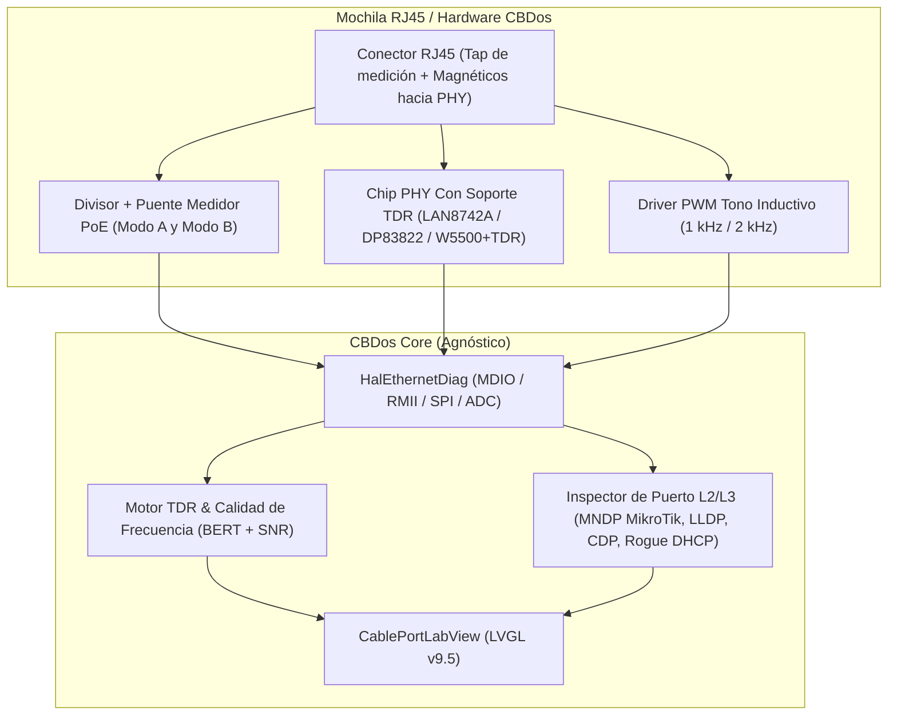

# Propuesta y Plan de Arquitectura: Suite de Certificación de Cables Ethernet y Diagnóstico de Puerto (CBDos NetTester)

> **Estado:** Propuesta Técnica / Plan de Arquitectura  
> **Fecha:** 19 de Octubre de 2026  
> **Targets:** ESP32-P4 (RMII + MDIO / JP1) y ESP32-S3 (SPI + JP1)  
> **Framework Gráfico:** LVGL v9.5 estricto  

---

## 1. Visión General

Reemplazar cuatro herramientas de campo independientes (Certificador TDR de cables, Detector PoE 24V/48V, Generador de Tonos inductivo y Analizador de Puerto MNDP/LLDP/DHCP) con una **Mochila RJ45 para CBDos** y una aplicación unificada en **LVGL v9.5 (`CablePortLabView`)**, orientada a tareas de **SysAdmin y Administración de Redes (entornos MikroTik / Cisco / Enterprise)**.

---

## 2. Capacidades de Capa 1 (Física del Cable)

### 2.1 Reflectometría en el Dominio del Tiempo (TDR — Distancia al Fallo)
Los transceptores PHY modernos compatibles con la MAC RMII del **ESP32-P4** (ej. **Microchip LAN8742A**, **TI DP83822** o **Motorcomm YT8512C**) integran un motor **TDR por hardware** accesible mediante registros extendidos del bus **MDIO (SMI)**:
- **Principio físico:** El PHY inyecta un pulso de alta velocidad en el par trenzado y mide en nanosegundos el tiempo de retorno de la reflexión producida por discontinuidades de impedancia ($\neq 100\,\Omega$).
- **Diagnósticos devueltos a CBDos:**
  - `OPEN` (Cable cortado o conector mal ponchado) + **Distancia exacta en metros** ($d = \frac{v \cdot t}{2}$, con NVP configurable $0.65c - 0.72c$, precisión $\pm 0.8\text{ m}$).
  - `SHORT` (Cortocircuito entre hilos del mismo par o entre pares distintos) + **Distancia exacta en metros**.
  - `MATCHED` (Terminación correcta de $100\,\Omega$ detectada en el extremo remoto / switch).

### 2.2 Salud en Frecuencia, Atenuación y Prueba BERT (*Bit-Error-Rate Test*)
Para determinar si un cable soporta la frecuencia de operación sin pérdida de paquetes ni interferencia electromagnética:
1. **Telemetría DSP del PHY (Registros MDIO):**
   - Lectura del índice de ganancia del ecualizador adaptativo (AGC/EQ) que revela la **atenuación en alta frecuencia (dB)** del cable.
   - Lectura en tiempo real de los contadores de hardware: `Symbol Error Counter (RX_ER)`, `False Carrier Sense` y `FCS/CRC Errors`.
2. **Prueba de Estrés Multivelocidad (10M vs 100M):**
   - CBDos fuerza la negociación primero a **10BASE-T (Manchester 10 MHz)** y luego a **100BASE-TX (MLT-3 31.25 MHz / 125 MBaud)**.
   - Envía una ráfaga de 10,000 tramas Ethernet crudas con patrones de estrés (`0x55555555` para máxima transición de reloj y `0xFFFFFFFF` para prueba de *baseline wander*).
   - Si 10 Mbps pasa con `0 errores` pero 100 Mbps presenta errores de símbolo o caída de SNR, CBDos diagnostica: ***"Cable degradado en alta frecuencia / par destrenzado o diafonía (NEXT)"***.

### 2.3 Mapa de Hilos (*Wiremap*) con Tapón Remoto Pasivo
- Con un pequeño conector RJ45 pasivo en el otro extremo del cable (con resistencias escalonadas/diodos entre los 8 pines), CBDos identifica antes de encender el enlace:
  - Cable directo (**T568B / T568A**) vs. Cable cruzado (*Crossover*).
  - Hilos individuales abiertos (`1..8`).
  - Pares invertidos o divididos (*Split pairs*).

### 2.4 Auditor de Alimentación PoE (Estándar vs. MikroTik Pasivo)
Antes de conectar equipos sensibles, un circuito de muestreo de alta impedancia en los pares **Modo A (Pines 1-2 / 3-6)** y **Modo B (Pines 4-5 / 7-8)** mide y muestra en pantalla:
- **Voltaje exacto y polaridad:**
  - `24V DC Pasivo (Modo B: 4,5+ / 7,8-)` $\rightarrow$ Típico de **MikroTik RouterBOARD / Ubiquiti**.
  - `48V–54V DC (802.3af / 802.3at / 802.3bt)` $\rightarrow$ Switches PoE empresariales.
  - `0V (Sin PoE)`.

### 2.5 Generador de Tonos Inductivo (*Tone Tracer / Fox & Hound*)
- Inyección de señal cuadrada modulada (1 kHz / 2 kHz alternante) en los pines del RJ45 controlada por un timer hardware del ESP32, permitiendo localizar el cable dentro de un rack o canaleta usando cualquier sonda inductiva comercial (*chicharra*).

---

## 3. Capacidades de Capa 2 y 3 (Suite SysAdmin / MikroTik en el Puerto)

Al conectar un cable activo de un switch o router a CBDos, la pestaña **Port Inspector** ejecuta una batería de pruebas automáticas en menos de 5 segundos:

| Prueba Automática | Protocolo / Mecanismo | Información Mostrada en CBDos |
| :--- | :--- | :--- |
| **Identificación de Equipo MikroTik** | **MNDP** (*MikroTik Neighbor Discovery Protocol*, UDP `5678`) | `Identity`, modelo de RouterBOARD, versión de RouterOS, MAC, IPv4/IPv6, `Uptime` y **nombre exacto de la interfaz/bridge** (`ether5`, `bridge-lan`). |
| **Identificación de Switch Enterprise** | **LLDP** (EtherType `0x88CC`) y **CDP** (`01:00:0C:CC:CC:CC`) | Nombre del Switch, **Puerto físico exacto** (`Gi1/0/14`), **VLAN ID nativa**, capacidades (PoE, Router, Switch) y IP de gestión. |
| **Detección de VLANs (Trunk Audit)** | Captura pasiva de cabeceras **IEEE 802.1Q** (`0x8100`) | Lista de todas las **VLAN IDs etiquetadas (*Tagged*)** que circulan por ese puerto de red. |
| **Auditoría de Servidores DHCP (Rogue DHCP)** | Envío de `DHCP DISCOVER` y escucha multi-respuesta de `DHCP OFFER` | Muestra **todos** los servidores DHCP que respondan en el segmento: IP del servidor, MAC + fabricante (OUI), Gateway entregado, DNS y alerta en rojo si hay más de un servidor DHCP activo. |
| **Verificación de Salida a Red / DNS** | ICMP Ping + Resolución DNS | Latencia al Gateway local, latencia a Internet (`1.1.1.1`) y tiempo de respuesta del servidor DNS interno en milisegundos. |

---

## 4. Diseño de Interfaz en LVGL v9.5 (`CablePortLabView`)

Integrada con `BaseView` y `HeaderBar` sobre `m_container`:
1. **Tab 1 — `Cable & TDR`:**
   - Dibujo esquemático de los 4 pares trenzados (`Par 1-2 Naranja`, `Par 3-6 Verde`, `Par 4-5 Azul`, `Par 7-8 Café`) con barras de longitud en metros y marcador visual rojo en la distancia exacta si hay corte o cortocircuito.
   - Indicador superior de **PoE (Voltaje, Modo A/B)**.
2. **Tab 2 — `Freq & BERT`:**
   - Botón `[ Ejecutar Certificación 10M / 100M ]`.
   - Gráfica en tiempo real de SNR/Atenuación, Tramas TX vs RX, Errores CRC y Errores de Símbolo (`0` = Cable Certificado OK).
3. **Tab 3 — `Switch Port (MNDP/LLDP/DHCP)`:**
   - Tarjeta resumen del puerto: *"Conectado a: MikroTik CCR2004 — Puerto: ether8 — VLAN: 20 — DHCP: 192.168.20.1 (OK)"*.
4. **Tab 4 — `Tone Generator`:**
   - Selector de cadencia de tono (`Continuo 1 kHz`, `Alternante 1/2 kHz`, `Pulso Rápido`) y par por el cual emitir.

---

## 5. Opciones de Implementación de Hardware por Plataforma

- **Opción 1 — Nativa de Alto Rendimiento en ESP32-P4 (RMII + MDIO):**
  - El ESP32-P4 usa su periférico `EMAC` interno conectado a un PHY **LAN8742A** o **DP83822** (que incluyen TDR por hardware en sus registros MDIO).
- **Opción 2 — Mochila Universal SPI + I2C/MDIO (Compatible con ESP32-S3 y ESP32-P4 por JP1):**
  - Una mochila conectada al puerto **JP1** con controlador Ethernet SPI (**W5500**) para las pruebas de Capa 2/3 (MNDP, LLDP, Rogue DHCP, Ping) combinada con el circuito medidor de PoE, generador de tonos y reflectometría/wiremap en pines dedicados.

---

## 6. Fases del Plan
1. **Fase 1 (Software Puro — Suite L2/L3):** Implementar el decodificador **MNDP (MikroTik)**, **LLDP/CDP** y el **Detector de Rogue DHCP** (que además funcionan desde ya sobre Wi-Fi en las placas actuales sin hardware extra y estarán listos para Ethernet).
2. **Fase 2 (Driver HAL Ethernet & TDR):** Crear `HalEthernetDiag` con lectura de registros MDIO extendidos (TDR de distancia al fallo, contadores de errores de símbolo y forzado 10M/100M).
3. **Fase 3 (Mochila Hardware RJ45 + PoE + Tone):** Definir esquemático de protección para medición de PoE 24V/48V y generador de tonos en `specs/hardware/`.
4. **Fase 4 (Vista LVGL v9.5):** Construir `CablePortLabView` con las 4 pestañas de diagnóstico y guardado de reportes en la MicroSD.
