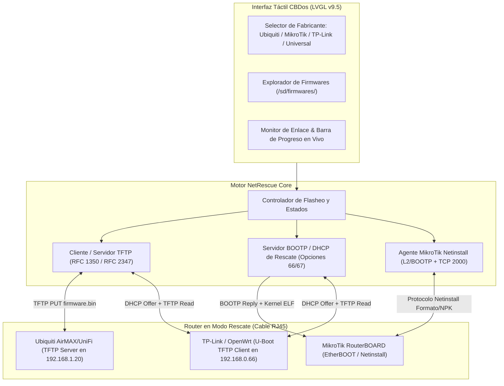

# 🛠️ Propuesta Técnica: Suite de Flasheo, Rescate y Unbricking de Routers en Campo (CBDos NetRescue)

* **Estado:** 💡 Propuesta Formal (En Revisión por el Usuario)  
* **Autor:** Equipo CBDos / kaber420  
* **Fecha:** 2026-10-20  
* **Target Primario:** ESP32-P4 (JC4880P443C - 400 MHz Dual-Core RISC-V, 32 MB PSRAM, Ethernet RMII 10/100, MicroSD)  
* **Target Secundario:** ESP32-S3 (JC3248W535 - Mochila RJ45 W5500 / LAN8720 por SPI, MicroSD)  
* **Framework Gráfico:** LVGL v9.5  
* **Ecosistema de Routers Objetivo:** **Ubiquiti** (AirMAX, UniFi, EdgeMAX), **MikroTik** (RouterBOARD / RouterBOOT), **TP-Link**, **OpenWrt** y dispositivos basados en **U-Boot / CFE**.  

---

## 📋 1. Resumen Ejecutivo y Motivación

En operaciones de soporte de redes, despliegues WISP y mantenimiento de infraestructura, una de las averías más críticas ocurre cuando un router o antena se "briquea" (falla de energía durante actualización, firmware corrupto o bucle de reinicio).

El procedimiento estándar de la industria exige conectar una laptop con cable Ethernet directo al router, configurar IPs estáticas manuales, desactivar firewalls de Windows/Linux y ejecutar herramientas pesadas como *MikroTik Netinstall*, utilidades TFTP de línea de comandos o tftpd32.

**CBDos NetRescue** convierte al dispositivo (especialmente la placa ESP32-P4 con su puerto Ethernet nativo y tarjeta MicroSD) en una **estación de flasheo y rescate de bolsillo autónoma**, permitiendo al técnico revivir, actualizar o cambiar de sistema operativo (ej. a OpenWrt) a routers en la torre o en el rack **sin necesidad de ordenador**.

---

## 🎯 2. Mecanismos de Flasheo por Fabricante



---

### 2.1. Módulo Ubiquiti (AirOS, UniFi y EdgeRouter)

#### Comportamiento del Router Ubiquiti:
* Al encender el equipo manteniendo pulsado el botón **Reset** durante 10-15 segundos (hasta que los LEDs parpadean en secuencia 1-3 y 2-4 alternante), el bootloader activa el **Modo de Rescate TFTP**.
* El router Ubiquiti levanta internamente una IP fija de rescate: **`192.168.1.20`** y arranca un servidor TFTP en el puerto 69 UDP esperando que le envíen el firmware.

#### Flujo de Flasheo en CBDos:
1. **Detección Automática de Enlace:** CBDos configura su interfaz Ethernet en `192.168.1.25/24`.
2. **Sondeo de Presencia:** Envía pings ICMP de baja frecuencia hacia `192.168.1.20` esperando el patrón de respuesta de Ubiquiti (TTL 128 en modo recovery).
3. **Transferencia TFTP (Modo Cliente PUT):**
   - El técnico selecciona en la pantalla táctil el firmware deseado (ej. `/sd/firmwares/ubiquiti/WA.v8.7.1.bin`).
   - CBDos inicia una petición `WRQ` (Write Request) en modo binario (*octet*) hacia `192.168.1.20:69`.
   - Transfiere el binario en bloques con soporte de negociación de tamaño de bloque (**RFC 2348 `blksize`** de hasta 1428 bytes para maximizar velocidad).
4. **Verificación y Barra de Progreso:**
   - La pantalla muestra el avance porcentual, tasa de transferencia (KB/s) y tiempo estimado.
   - Tras enviar el último bloque, CBDos espera el ciclo de escritura en la memoria Flash del router y notifica al usuario cuando los LEDs del equipo vuelven a parpadear normalmente.

---

### 2.2. Módulo MikroTik (RouterBOARD / RouterOS Netinstall)

#### Comportamiento de MikroTik:
* Al encender el RouterBOARD con el botón **Reset** sostenido hasta que el LED de usuario/ACT se apaga por completo, el microcódigo **RouterBOOT** entra en modo **EtherBOOT**.
* El router emite tramas de broadcast **BOOTP** (UDP puerto 67) buscando un servidor Netinstall para descargar el kernel inicial en su memoria RAM.

#### Flujo de Rescate en CBDos:
1. **Servidor BOOTP Especializado:**
   - CBDos escucha en el puerto 67 y detecta la dirección MAC de la RouterBOARD.
   - Responde con un paquete `BOOTP Reply` asignándole una IP temporal (ej. `192.168.88.2`) y entregándole la IP de CBDos (`192.168.88.1`) como servidor de arranque.
2. **Carga del Kernel de Rescate:**
   - MikroTik solicita por TFTP el kernel inicial RouterOS o imagen ELF. CBDos lo sirve desde la MicroSD.
3. **Flasheo de Paquetes (`.npk`):**
   - Una vez que el kernel de MikroTik arranca en RAM, levanta el servicio Netinstall en el puerto TCP 2000.
   - CBDos envía las instrucciones de particionamiento, formateo y transfiere el paquete `routeros-*.npk`.
   - MikroTik graba la NAND y emite la orden de reinicio limpio.

---

### 2.3. Módulo U-Boot / OpenWrt Libre (Routers Retail No-ISP)

Muchos routers estándar comerciales sin bloqueos de operadora (ej. routers retail con U-Boot libre o equipos que ya corren **OpenWrt**) funcionan como clientes TFTP buscando rescatarse desde una IP fija:

| Plataforma / Bootloader | IP que busca el Router | Nombre de archivo requerido | Modo en CBDos |
| :--- | :--- | :--- | :--- |
| **U-Boot Genérico (OpenWrt)** | DHCP o `192.168.1.1` | `openwrt-initramfs.bin` | Servidor DHCP (Opt 66/67) + TFTP |
| **D-Link / CFE Recovery** | `192.168.0.1` | `firmware.bin` | Servidor o Cliente HTTP/TFTP |
| **Cisco Switches (ROMmon)** | Asignada por técnico | `cisco_ios.bin` (comando `tftpdnld`) | Servidor TFTP en IP estática |
| **TP-Link Retail Antiguo (Sin ISP)** | `192.168.0.66` | `<modelo>_tp_recovery.bin` | Servidor TFTP en `192.168.0.66` |

---

### 2.4. Módulo TP-Link Agile Config / Aginet Server (Emulador de Bolsillo para WISPs e ISPs)

**El sistema Agile Config (ahora integrado en la suite Aginet) funciona precisamente mediante un Servidor DHCP y TFTP en el puerto WAN.**

#### ¿Cómo opera el protocolo oficial TP-Link Agile Config?
Para evitar configurar routers uno por uno desde su interfaz web, TP-Link provee a los operadores la utilidad de PC *Agile Config Server*. El mecanismo interno es puramente de red:
1. **Topología y Subred Fija:**
   - La herramienta exige configurar la interfaz Ethernet del servidor en la IP fija **`192.168.66.10`** (máscara `255.255.255.0`).
   - El router TP-Link compatible se conecta **específicamente por su puerto WAN** (o a través de un switch común).
2. **Ciclo DHCP + TFTP al Arranque:**
   - Al encender el router TP-Link (o mantener reset al iniciar), su microcódigo emite una solicitud `DHCP Discover` a través de la interfaz WAN buscando el rango `192.168.66.x`.
   - El servidor Agile responde entregándole una IP dinámica (ej. `192.168.66.100`) y apuntando como servidor TFTP a `192.168.66.10`.
   - Acto seguido, el router inicia una transferencia **TFTP** (puerto 69 UDP) para descargar automáticamente:
     - El binario de actualización de firmware (`upgrade.bin`).
     - El archivo de configuración de fábrica personalizado (`default_config.bin` o archivo específico mapeado por la dirección MAC del equipo).
3. **Grabación en Flash:**
   - Los LEDs del router parpadean secuencialmente mientras el firmware y la configuración se escriben en la partición protegida de la flash SPI.
   - El router se reinicia automáticamente con la nueva versión y los nuevos parámetros de fábrica grabados.

#### Implementación en CBDos (`AgileServerProfile`):
CBDos puede **emular al 100% el servidor oficial Agile Config** sin requerir un PC con Windows:
* **Perfil 1-Click "TP-Link Agile":** CBDos configura su IP en `192.168.66.10/24`.
* **Servidor DHCP Integrado:** Atiende peticiones en la interfaz WAN del router en el rango `192.168.66.100-200`.
* **Servidor TFTP en PSRAM / MicroSD:** Sirve los archivos ubicados en `/sd/firmwares/tplink/agile/` (firmwares `.bin` y configuraciones personalizadas del ISP).
* **Uso en Campo:** Un técnico WISP puede conectar un router TP-Link recién sacado de caja por el puerto WAN directo a CBDos, encenderlo, y en 30 segundos el router queda actualizado y configurado con la plantilla del ISP de forma totalmente autónoma.

> [!NOTE]
> **Consideración de Firmware:** Para routers que pertenecen a flotas Agile de operadora, los binarios inyectados por TFTP deben ser imágenes oficiales de la línea Agile o firmadas para ese modelo de hardware; el protocolo de transporte es estrictamente DHCP + TFTP.

---

## 📱 3. Diseño de la Interfaz de Usuario (LVGL v9.5)

### 3.1. Pantalla Principal de Selección (`NetRescueMainView`)
```
┌────────────────────────────────────────────────────────┐
│ [ < Volver ]            NetRescue            [ETH: 100M]│
├────────────────────────────────────────────────────────┤
│  Selecciona la plataforma del router a recuperar:     │
│                                                        │
│  ┌────────────────────────┐  ┌────────────────────────┐│
│  │      📡 UBIQUITI       │  │      📶 MIKROTIK       ││
│  │ AirMAX / UniFi / Edge  │  │  RouterBOARD Netinstall││
│  │ (TFTP Client a .1.20)  │  │ (BOOTP + TCP Netinst)  ││
│  └────────────────────────┘  └────────────────────────┘│
│  ┌────────────────────────┐  ┌────────────────────────┐│
│  │    🌐 TP-LINK AGILE    │  │      ⚙ UNIVERSAL      ││
│  │ Servidor WAN .66.10    │  │ TFTP Client / Server   ││
│  └────────────────────────┘  └────────────────────────┘│
│                                                        │
│  Estado del Puerto: [ LINK ACTIVO - 100 Mbps Full-Duplex]│
│  IP Local CBDos:   [ 192.168.66.10                     ]│
└────────────────────────────────────────────────────────┘
```

### 3.2. Pantalla de Flasheo en Curso (`NetRescueFlashView`)
```
┌────────────────────────────────────────────────────────┐
│ [ Cancelar ]       Flasheando Ubiquiti       [ETH: TX] │
├────────────────────────────────────────────────────────┤
│ Destino:   192.168.1.20 (Ubiquiti Recovery Mode)       │
│ Archivo:   /sd/firmwares/WA.v8.7.1.33261.bin           │
│ Tamaño:    8.42 MB                                     │
│                                                        │
│ Progreso:                                              │
│ [████████████████████░░░░░░░░░░]  68%                  │
│                                                        │
│ Velocidad: 820 KB/s    | Bloque: 4120 / 6050           │
│ Tiempo restante: 00:04 seg                             │
│                                                        │
│ [LOG EN VIVO]                                          │
│ > Ping 192.168.1.20 OK (TTL=128)                       │
│ > Negociado blksize=1428 bytes                         │
│ > Transfiriendo bloques de firmware...                 │
│                                                        │
│ ⚠️ NO DESCONECTES EL CABLE DE RED NI APAGUES EL EQUIPO  │
└────────────────────────────────────────────────────────┘
```

---

## 🔒 4. Salvaguardas y Seguridad contra Briqueos

1. **Verificación de Integridad Pre-Flasheo:**
   - Antes de iniciar cualquier transferencia, CBDos calcula y verifica el hash **MD5 / SHA256** del archivo en la MicroSD contra un archivo `.md5` acompañante para evitar inyectar firmwares corruptos o descargas incompletas.
2. **Validación de Cabeceras Mágicas de Firmware:**
   - **Ubiquiti:** Verificación del *magic byte* UBNT / `OPEN` header.
   - **MikroTik:** Validación de cabecera de paquete RouterOS NPK.
   - **U-Boot:** Verificación de cabecera estándar `uImage` (Magic `0x27051956`).
3. **Detección de Caída de Enlace Físico (Link Down):**
   - Si el cable RJ45 se desconecta durante la transferencia, el proceso se aborta de forma segura con advertencia acústica y visual en pantalla.

---

## 🚦 5. Hoja de Ruta de Implementación (Roadmap)

### Fase 1: Motor TFTP Dual (Cliente y Servidor) en `core/services/`
* Implementación del protocolo TFTP estándar (RFC 1350) y extensiones de rendimiento (RFC 2347, RFC 2348 para `blksize=1428` y `timeout`).
* Soporte para lecturas y escrituras directas contra el sistema de archivos de la **MicroSD (`/sd/`)**.

### Fase 2: Módulo Ubiquiti Flasher (TFTP Client PUT)
* Lógica de autoconfiguración de IP (`192.168.1.25`), detección de ping a `192.168.1.20` y comando `PUT` del binario con cálculo de estadísticas en tiempo real.
* Prueba de campo con antenas Nanostation / Loco M5 / LiteBeam / UniFi AP.

### Fase 3: Módulos Servidor (TP-Link y U-Boot Universal)
* Servidor DHCP minimalista de asignación inmediata (entrega de IP estática al router cliente).
* Perfiles rápidos precargados en la UI de CBDos.

### Fase 4: Módulo Avanzado MikroTik Netinstall
* Implementación de la captura de tramas BOOTP de EtherBOOT y handshake TCP 2000 para flasheo de `.npk`.
* Integración con la UI táctil LVGL v9.5 y notificaciones en `HeaderBar`.
