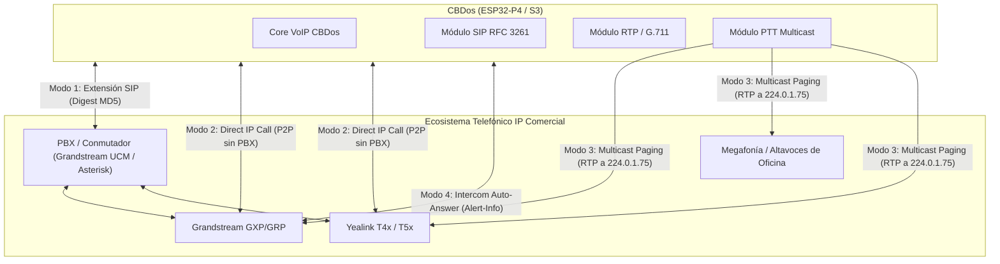
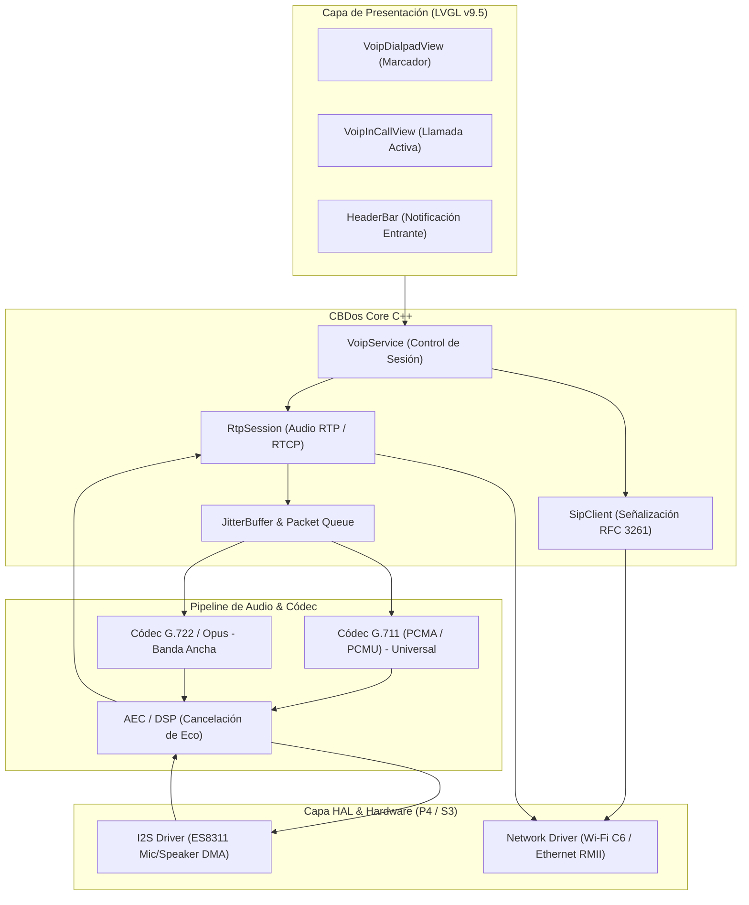

# 📞 Propuesta Técnica: Teléfono IP, Cliente SIP & Intercomunicador VoIP para CBDos

* **Estado:** 💡 Propuesta Formal (En Revisión por el Usuario)  
* **Autor:** Equipo CBDos / kaber420  
* **Fecha:** 2026-10-20  
* **Target Primario:** ESP32-P4 (JC4880P443C - 400 MHz Dual-Core RISC-V, 32 MB PSRAM, Códec I2S ES8311, Wi-Fi C6 / Ethernet RMII)  
* **Target Secundario:** ESP32-S3 (JC3248W535 - 240 MHz Dual-Core Xtensa, 8 MB PSRAM, Audio I2S, Wi-Fi nativo)  
* **Framework Gráfico:** LVGL v9.5  
* **Arquitectura:** Núcleo Agnóstico C++ (`core/`) + HAL Abstracta de Audio/Red + Integración HeaderBar  

---

## 📋 1. Resumen Ejecutivo y Visión

La presente propuesta define la arquitectura técnica, protocolos y diseño de interfaz para dotar a **CBDos** de capacidades de **Telefonía IP nativa y comunicación por voz bidireccional en tiempo real**.

Aprovechando la pantalla táctil capacitiva, el subsistema de audio I2S (micrófono + altavoz) y la conectividad de red del hardware actual (JC4880 con P4 + C6 / Ethernet), CBDos se transforma en un **terminal telefónico IP autónomo**, capaz de operar tanto en redes empresariales/hogareñas con conmutadores PBX (**Grandstream UCM, Asterisk, FreePBX, FreeSWITCH**) como en modo **Direct IP Call / Walkie-Talkie P2P directo** sin depender de servidores externos.

---

## 🌐 2. Ecosistema de Telefonía Comercial: Compatibilidad con Grandstream, Yealink, Fanvil y Cisco

Los teléfonos IP comerciales de escritorio (Grandstream series GXP/GRP/WP, Yealink series T3/T4/T5, Fanvil, Cisco Multiplatform Firmware, Polycom y Snom) **no utilizan protocolos propietarios de audio**. Todos se rigen estrictamente bajo el estándar **IETF SIP (RFC 3261) y RTP (RFC 3550)**.

CBDos interactúa con este ecosistema a través de cuatro mecanismos complementarios:



### 2.1. Modo 1: Registro como Extensión en PBX (Centralita)
* **Compatibilidad:** 100% estándar con **Grandstream UCM6200/UCM6300/UCM6500**, Asterisk, FreePBX, OpenSIPS e Issabel.
* **Flujo de Señalización:**
  1. CBDos envía `REGISTER sip:pbx.local` (puerto 5060 UDP).
  2. El servidor responde `401 Unauthorized` con un reto criptográfico (`nonce`, `realm`).
  3. CBDos calcula la firma **Digest MD5** y reenvía el `REGISTER` con cabecera `Authorization`.
  4. PBX responde `200 OK` (extensión registrada y lista para emitir/recibir llamadas con marcado de 3 o 4 dígitos).

### 2.2. Modo 2: Llamada Directa por IP (*Direct IP Call* - Cero Servidores)
* **Función Nativa de Grandstream y Yealink:** Permite llamar punto a punto entre dispositivos conectados a la misma LAN/Wi-Fi sin necesidad de conmutador intermedio.
* **Marcación desde Grandstream a CBDos:**
  - En el teclado físico de un teléfono Grandstream, el usuario marca la dirección IP del ESP32 usando la tecla `*` como punto decimal:  
    *Ejemplo de marcado en teclado físico:* `192*168*1*45` + tecla de llamada.
  - El teléfono Grandstream emite un paquete `INVITE sip:192.168.1.45:5060`.
  - CBDos detecta la llamada entrante, muestra la alerta en pantalla y al descolgar abre el flujo RTP de voz bidireccional.
* **Marcación desde CBDos a Grandstream:**
  - El usuario ingresa en el marcador táctil de CBDos la IP del teléfono Grandstream o la selecciona de la libreta de direcciones local.
  - CBDos envía `INVITE sip:192.168.1.50:5060`. El teléfono Grandstream suena y abre la llamada al responder.

### 2.3. Modo 3: Megafonía y Voceo Automático (*Multicast Paging*)
* **Estándar de la Industria para Voceo:** Los teléfonos Grandstream, Yealink y Fanvil disponen de una función nativa denominada **Paging / Intercom (Multicast Listening Address)**.
* **Funcionamiento:**
  - Los teléfonos comerciales de la oficina se configuran para escuchar en una dirección IP Multicast común (ej. `224.0.1.75:50008` o `239.255.255.245:10000`).
  - CBDos, en modo **Walkie-Talkie / Push-to-Talk (PTT)**, emite paquetes RTP directamente a esa dirección multicast.
  - **Resultado:** **Todos los teléfonos Grandstream de la red abren automáticamente su altavoz sin timbrar**, reproduciendo la voz del operador de CBDos en tiempo real como sistema de megafonía general o alerta de seguridad.

### 2.4. Modo 4: Intercomunicador con Auto-Respuesta (*Auto-Answer via SIP Headers*)
* Para aplicaciones de control de acceso, conserjería o videoportero, CBDos puede solicitar al teléfono Grandstream/Yealink que descuelgue automáticamente sin intervención humana mediante cabeceras estándar en el paquete `INVITE`:
  - **Grandstream:** `Call-Info: <sip:192.168.1.45>;answer-after=0`
  - **Yealink / SNOM:** `Alert-Info: info=AutoAnswer` o `Alert-Info: Ring Answer`
* Permite comunicación de escucha y vigilancia autorizada en puestos fijos.

---

## 📡 3. Protocolos de Red, Señalización y Gestión de Flota

| Categoría | Protocolo / RFC | Función en CBDos & Teléfonos Comerciales |
| :--- | :--- | :--- |
| **Señalización** | **SIP (RFC 3261)** | Establecimiento, modificación y cierre de llamadas (puerto UDP/TCP 5060). |
| **Descripción de Sesión** | **SDP (RFC 4566)** | Negociación de códecs (G.711 / G.722) y asignación de puertos dinámicos de audio. |
| **Transporte de Audio** | **RTP (RFC 3550)** | Streaming de tramas de voz de 20 ms con marcas de tiempo para jitter control. |
| **Calidad de Servicio** | **RTCP (RFC 3556)** | Monitoreo de latencia (RTT), paquetes perdidos y jitter en la llamada activa. |
| **Tonos DTMF** | **RFC 4733 / RFC 2833** | Transmisión de dígitos fuera de banda (`telephone-event`, Payload 101) para navegar IVRs ("Presione 1 para ventas"). Alternativa: `SIP INFO`. |
| **Priorización de Red** | **DiffServ / DSCP QoS** | Marcado de cabecera IP: **SIP con DSCP CS3 (24)** y **RTP con DSCP EF (46)** para garantizar cero retardo en switches administrables. |
| **Descubrimiento de Red** | **LLDP-MED (802.1AB)** | Permite al switch corporativo asignar automáticamente la VLAN de Voz prioritaria. |
| **Auto-Aprovisionamiento** | **DHCP Option 66 / XML** | Carga remota de configuraciones de flota (`cfg<MAC>.xml` vía HTTP/TFTP) idéntico a Grandstream. |

---

## 🏛️ 4. Principios de Arquitectura CBDos

1. **Pureza Arquitectónica (`core/` agnóstico):**
   - El estado de la llamada (`IDLE`, `DIALING`, `RINGING`, `CONNECTED`, `HOLD`), la agenda telefónica y la máquina de estados SIP residen en `core/services/voip_service.hpp`.
   - Cero llamadas a sockets BSD o I2S dentro de `core/`; todo se comunica a través de `INetworkAdapter` e `IAudioDriver`.
2. **Offline-First & Cero Arranque Espurio:**
   - La pila VoIP no levanta sockets ni transceptores de red automáticamente al encender el dispositivo.
   - El subsistema se inicializa exclusivamente cuando el usuario abre la app de Teléfono o activa explícitamente el servicio de guardia en segundo plano.
3. **Cero Polling y Reactividad:**
   - La recepción SIP y RTP se procesa mediante una tarea FreeRTOS bloqueada en `select()` / colas de eventos.
   - La UI solo se redibuja cuando ocurre un evento de estado (`onStateChange`, `onIncomingCall`, `onCodecStats`).
4. **Ciclo de Vida y Recuperación de Memoria ("Hold-to-Close"):**
   - Si el usuario minimiza la app (toque corto en `<`), la sesión SIP permanece registrada en fondo para recibir llamadas.
   - Si el usuario realiza un cierre total (*Hold-to-Close* de 2s), se envía el desregistro SIP (`REGISTER Expires: 0`), se cierran los sockets UDP, se detiene el DMA de I2S y se libera la RAM al 100%.

---

## 🛠️ 5. Pila de Protocolos y Audio Pipeline



### 5.1. Códecs de Voz
* **G.711 A-law / µ-law (Universal):**
  - Muestreo: 8.000 Hz, 8 bits por muestra (64 kbps de audio, ~80 kbps con cabeceras IP/UDP/RTP).
  - Consumo de CPU menor al 1% en el P4; compatible con el 100% de terminales Grandstream, Cisco y conmutadores PSTN.
* **G.722 (HD Voice):**
  - Muestreo: 16.000 Hz (64 kbps). El estándar de alta fidelidad nativo de Grandstream y Yealink para conversaciones nítidas.
* **Opus (Adaptable):**
  - Soporte para enlaces Wi-Fi con ancho de banda variable.

### 5.2. Latencia y Control de Audio
* **Paquetes RTP:** Tramas de 20 ms de audio (160 bytes por paquete G.711).
* **Jitter Buffer:** Buffer circular elástico de 40 a 60 ms en PSRAM para absorber fluctuaciones de la red Wi-Fi sin que se produzcan chasquidos.
* **Prevención de Eco:** Si se usa en altavoz abierto, se aprovecha la biblioteca de procesamiento de señal (AEC) de Espressif en el core del P4.

---

## 📱 6. Diseño de Interfaz de Usuario (LVGL v9.5)

### 6.1. Marcador Telefónico (`VoipDialpadView`)
```
┌────────────────────────────────────────────────────────┐
│ [ < Volver ]            Teléfono IP       [Reg: Ext 104]│
├────────────────────────────────────────────────────────┤
│                                                        │
│                  [  2 0 4 _            ] [ ⌫ Borrar ]  │
│                                                        │
│            ┌───────┐      ┌───────┐      ┌───────┐     │
│            │   1   │      │   2   │      │   3   │     │
│            │       │      │  ABC  │      │  DEF  │     │
│            └───────┘      └───────┘      └───────┘     │
│            ┌───────┐      ┌───────┐      ┌───────┐     │
│            │   4   │      │   5   │      │   6   │     │
│            │  GHI  │      │  JKL  │      │  MNO  │     │
│            └───────┘      └───────┘      └───────┘     │
│            ┌───────┐      ┌───────┐      ┌───────┐     │
│            │   7   │      │   8   │      │   9   │     │
│            │ PQRS  │      │  TUV  │      │ WXYZ  │     │
│            └───────┘      └───────┘      └───────┘     │
│            ┌───────┐      ┌───────┐      ┌───────┐     │
│            │   *   │      │   0   │      │   #   │     │
│            └───────┘      └───────┘      └───────┘     │
│                                                        │
│                    [ 📞 LLAMAR ]                       │
│                                                        │
│       [ 📇 Directorio ]   [ 🕒 Historial ]   [ ⚙ Config ]│
└────────────────────────────────────────────────────────┘
```

### 6.2. Pantalla de Llamada Activa (`VoipInCallView`)
```
┌────────────────────────────────────────────────────────┐
│ [ < Ocultar ]         Llamada en Curso       [ 01:24 ] │
├────────────────────────────────────────────────────────┤
│                                                        │
│                     👤 Ofic. Despacho                  │
│                        Extensión: 204                  │
│                     Códec: G.711u / 64 kbps            │
│                                                        │
│            ┌─────────────┐       ┌─────────────┐       │
│            │  🎤 MUTE    │       │ 🔊 ALTAVOZ  │       │
│            │ [Activado]  │       │  [Nivel: 8] │       │
│            └─────────────┘       └─────────────┘       │
│                                                        │
│                   ┌───────────────────┐                │
│                   │    🔴 COLGAR     │                │
│                   └───────────────────┘                │
│                                                        │
│            Estadísticas: RTT: 12ms | Pérdida: 0.0%    │
└────────────────────────────────────────────────────────┘
```

---

## 🚦 7. Hoja de Ruta de Implementación (Roadmap)

### Fase 1: Subsistema de Transporte RTP y Códec G.711 (Loopback y P2P)
* Implementar serializador/deserializador de paquetes RTP (RFC 3550).
* Integrar el códec G.711 A-law / µ-law para muestreo a 8 kHz bidireccional sobre los buffers I2S existentes.
* Prueba de concepto: Audio bidireccional P2P entre el ESP32-P4 y una PC o script Python con audio RTP.

### Fase 2: Pila SIP y Modos de Llamada
* Implementar cliente SIP User Agent minimalista (métodos `REGISTER`, `INVITE`, `ACK`, `BYE`, `CANCEL`).
* Negociación SDP simple (Session Description Protocol) para acordar puertos RTP y códec G.711.
* Validación de:
  - Registro contra PBX Asterisk / Grandstream UCM.
  - Llamada directa por IP (*Direct IP Call*) a un teléfono Grandstream.

### Fase 3: Vistas de Usuario en LVGL v9.5
* Creación de `VoipDialpadView` (teclado numérico táctil, display de número y botón de llamada).
* Creación de `VoipInCallView` (temporizador, mute, colgar, barra de volumen).
* Notificación emergente (*Toast / Modal*) ante llamadas entrantes y badges en `HeaderBar`.

### Fase 4: Modo Voceo Multicast (Megafonía Grandstream) y Walkie-Talkie
* Emisión Multicast UDP a la IP de paging de Grandstream (`224.0.1.75`).
* Interfaz táctil de Walkie-Talkie Push-to-Talk con activación instantánea de audio.
* Calibración de ecualización y cancelador de eco en altavoz.

---

## 🔒 8. Recursos y Memoria
* **Consumo de Memoria:** La pila SIP ligera + buffers RTP circulares requiere aproximadamente **~35 KB de RAM**, lo cual es trivial en el ESP32-P4 con 32 MB de PSRAM y perfectamente asumible en el ESP32-S3.
* **Seguridad:** Autenticación SIP Digest MD5 obligatoria. Preparado para futuras extensiones con SIPS (SIP sobre TLS) y SRTP para cifrado militar de voz.
