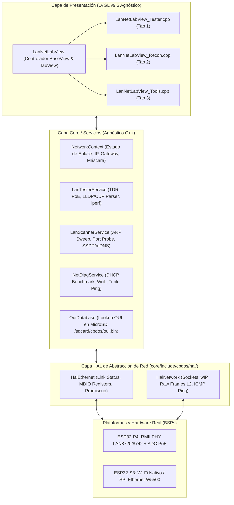

# Propuesta y Plan de Arquitectura: LAN NetLab (Suite Unificada de Diagnóstico y Laboratorio de Red)

> **Estado:** 💡 Propuesta Técnica y Plan de Arquitectura  
> **Fecha:** 20 de Octubre de 2026  
> **Targets:** ESP32-P4 (RMII PHY LAN8720/LAN8742 / JC4880P443C) y ESP32-S3 (JC3248W535 + Wi-Fi / Mochila W5500)  
> **Framework Gráfico:** LVGL v9.5 estricto (Agnóstico, BaseView, TabView modular)  
> **Ubicación Oficial:** `specs/proposals/proposal_lan_netlab_unified_suite.md`  

---

## 1. Visión General y Filosofía de Diseño

En operaciones de campo (WISP, Datacenter, cableado estructurado, soporte de oficina), un técnico tradicionalmente carga con múltiples aparatos:
1. Un **probador/certificador de cables** y detector PoE (Capa 1).
2. Un **analizador de switch / LLDP pocket tool** como *Netool.io* o *LinkRunner* (Capa 2).
3. Una **laptop** para ejecutar escaneo de subred ARP/IP, detección de cámaras y escaneo de puertos (Capa 3/4).
4. Herramientas de diagnóstico de red como Ping continuo, pruebas de DHCP y *Wake-on-LAN* (Capa 3/7).

**LAN NetLab** unifica estas cuatro disciplinas en una **sola aplicación táctica en CBDos**, organizada con la probada arquitectura de **Pestañas Agrupadas Modulares** (`core/src/ui/views/lan_netlab/`):

```
┌────────────────────────────────────────────────────────────────────────┐
│                              LAN NETLAB                                │
│                     (Suite Unificada de Red)                           │
├─────────────────────┬────────────────────┬─────────────────────────────┤
│   🔌 TAB 1: TESTER  │   🔍 TAB 2: RECON  │       🛠️ TAB 3: TOOLS       │
│  (Capa 1 & Capa 2)  │ (Capa 3 / 4 / IoT) │      (Diagnóstico Activo)   │
├─────────────────────┼────────────────────┼─────────────────────────────┤
│ • Link PHY / Speed  │ • Barrido ARP /24  │ • Benchmark DHCP (DORA)     │
│ • TDR Longitud Par  │ • Lookup OUI MicroSD│ • Detección Rogue DHCP     │
│ • Detección PoE     │ • Top Ports Probe  │ • Triple Ping con Gráfica   │
│ • LLDP / CDP / MNDP │ • mDNS / SSDP IoT  │ • Wake-on-LAN (WoL)         │
│   (Switch, Port,    │ • Cámaras ONVIF    │ • Test Throughput iperf3    │
│    VLAN ID)         │   y RTSP Streams   │ • Benchmark de DNS          │
└─────────────────────┴────────────────────┴─────────────────────────────┘
```

---

## 2. Diagrama de Arquitectura del Sistema



---

## 3. Especificación Detallada por Pestaña

### 🔌 3.1. Tab 1: Tester de Enlace, Cable y Switch (`LanNetLabView_Tester.cpp`)
* **Propósito:** Responder inmediatamente: *"¿El medio físico está sano, tengo enlace y a qué equipo de red estoy conectado?"*.
* **Capacidades Capa 1 (Física):**
  * **Estado de Link y Negociación:** 10M / 100M / 1000M, Full-Duplex / Half-Duplex, Polaridad Auto-MDIX.
  * **TDR (Reflectometría de Dominio Temporal):**
    * Detección de par Abierto (`OPEN`), Cortocircuito (`SHORT`) o Terminado (`MATCHED 100Ω`).
    * Estimación de longitud de cable en metros mediante cálculo de tiempo de vuelo en PHY con registros MDIO.
  * **Detección PoE (en placas/mochilas equipadas con divisor ADC):**
    * Detección de PoE Pasivo (24V) o Estándar 802.3af/at (48V) en pares A/B.
* **Capacidades Capa 2 (Enlace e Infraestructura):**
  * **Sniffer Pasivo de Tramas de Descubrimiento:**
    * **LLDP (IEEE 802.1AB):** Nombre del switch (`SysName`), Modelo (`SysDesc`), Puerto exacto (`PortId` ej. `GigabitEthernet 1/0/24`) y VLAN asignada (`PVID`).
    * **CDP (Cisco Discovery Protocol):** Switch Cisco, modelo, VTP Management Domain, Native VLAN.
    * **MNDP (MikroTik Neighbor Discovery):** Nombre del RouterOS, versión de firmware, modelo de Board y MAC.

---

### 🔍 3.2. Tab 2: Reconocimiento e Inventario LAN (`LanNetLabView_Recon.cpp`)
* **Propósito:** Responder: *"¿Qué dispositivos están conectados en esta subred y qué servicios ofrecen?"*.
* **Capacidades Capa 3 y 4:**
  * **Barrido ARP Ultrarrápido:** Escaneo de subred /24 completa en menos de 2.5 segundos mediante inyección asíncrona de tramas ARP sin saturar el heap lwIP.
  * **Identificación de Fabricante OUI:** Resolución de los primeros 3 octetos de la MAC contra la base binaria `/sdcard/cbdos/oui.bin` o caché en RAM (Apple, Ubiquiti, MikroTik, Hikvision, Espressif, etc.).
  * **Perfilado de Servicios Críticos (Top Ports):**
    * Sondeo no invasivo TCP de puertos clave: SSH (22), Telnet (23), HTTP (80), HTTPS (443), RTSP (554), MQTT (1883), SMB (445), WinBox (8291).
* **Capacidades Capa 7 (IoT & Cámaras IP):**
  * **Multicast SSDP (UPnP) y mDNS:** Descubrimiento pasivo y activo de dispositivos multimedia (Roku, Chromecast, bocinas inteligentes) y cámaras de videovigilancia ONVIF/Hikvision/Dahua con extracción directa de sus URLs RTSP de streaming.

---

### 🛠️ 3.3. Tab 3: Herramientas de Diagnóstico Activo (`LanNetLabView_Tools.cpp`)
* **Propósito:** Resolver problemas de conectividad, rendimiento y administración remota sin recurrir a una PC.
* **Herramientas Integradas:**
  1. **Benchmark DHCP (DORA Test) & Detección de Rogue DHCP:**
     * Mide el tiempo exacto en milisegundos desde el `DHCP Discover` hasta el `DHCP ACK`.
     * Alerta crítica inmediata si responden dos o más servidores DHCP distintos en el mismo segmento (*Rogue DHCP*).
  2. **Triple Ping Interactivo con Gráfica:**
     * Monitoreo simultáneo y en tiempo real de 3 saltos fundamentales:
       * Salto 1: Gateway Local (ej. `192.168.1.1`).
       * Salto 2: DNS Primario (ej. `1.1.1.1` o `8.8.8.8`).
       * Salto 3: Destino WAN de referencia (ej. `google.com`).
     * Visualización con minigráfica sparkline de latencia y contador de paquetes perdidos (`packet loss`).
  3. **Wake-on-LAN (WoL):**
     * Envío de tramas *Magic Packet* UDP (`FF:FF:FF:FF:FF:FF` + 16 repeticiones de la MAC destino) para encender PCs, NAS o servidores directamente desde el listado de Recon o ingresando la MAC manualmente.
  4. **Cliente de Rendimiento iperf3:**
     * Test de throughput TCP/UDP de ancho de banda real contra un servidor iperf3 en la LAN, mostrando Mbps reales alcanzados por el hardware.

---

## 4. Diseño de Interfaz Gráfica (LVGL v9.5)

### 4.1. Mockup UI — Pestaña 1: Tester de Enlace y Switch (320x480 / 480x800)
```text
┌────────────────────────────────────────────────────────┐
│  [=] LAN NETLAB          [ETH: 100M-FD] [🔋 92%] 14:30 │  <-- HeaderBar Integrada
├────────────────────────────────────────────────────────┤
│ [  🔌 TESTER  ]   [  🔍 RECON  ]   [  🛠️ TOOLS  ]      │  <-- TabBar Superior
├────────────────────────────────────────────────────────┤
│ ┌── ESTADO DEL ENLACE FÍSICO ────────────────────────┐ │
│ │ Estado:   ● LINK ACTIVO (Auto-MDIX Normal)         │ │
│ │ Velocidad: 100 Mbps Full-Duplex                    │ │
│ │ Longitud: 24.5 m (Par A: OK | Par B: OK)           │ │
│ │ PoE:      802.3af ACTIVO (48V Detectado - Par A)   │ │
│ └────────────────────────────────────────────────────┘ │
│ ┌── VECINO L2 (LLDP / CDP / MNDP) ───────────────────┐ │
│ │ Switch:  SW-CORE-PISO2 (Cisco Catalyst 2960)       │ │
│ │ Puerto:  GigabitEthernet 1/0/18                    │ │
│ │ VLAN:    VLAN 20 (VLAN_VOIP_DATA)                  │ │
│ │ IP Mgmt: 10.20.0.2                                 │ │
│ └────────────────────────────────────────────────────┘ │
│ ┌── IP ASIGNADA POR DHCP ────────────────────────────┐ │
│ │ IP: 10.20.0.145/24     | GW:  10.20.0.1            │ │
│ │ Servidor DHCP: 10.20.0.1 (T. Respuesta: 18 ms)     │ │
│ └────────────────────────────────────────────────────┘ │
│ [ ▶ Iniciar Test TDR ]    [ 🔄 Escuchar Vecinos LLDP ] │
└────────────────────────────────────────────────────────┘
```

### 4.2. Mockup UI — Pestaña 2: Reconocimiento e Inventario
```text
┌────────────────────────────────────────────────────────┐
│  [=] LAN NETLAB          [ETH: 100M-FD] [🔋 92%] 14:30 │
├────────────────────────────────────────────────────────┤
│ [  🔌 TESTER  ]   [  🔍 RECON  ]   [  🛠️ TOOLS  ]      │
├────────────────────────────────────────────────────────┤
│ Red: 10.20.0.0/24 | Hosts: 14 activos | Filtro: [Todos]│
│ [ ▶ Escanear Subred ]  [ 💾 Guardar a SD ]             │
│ ────────────────────────────────────────────────────── │
│ ┌─ 10.20.0.1  gw.local ──────────────────────────────┐ │
│ │ MAC: 00:0C:42:AA:11:02 (MikroTik Routerboard)      │ │
│ │ Latencia: 1.2 ms | Puertos: [22] [80] [443] [8291] │ │
│ └────────────────────────────────────────────────────┘ │
│ ┌─ 10.20.0.45 cam-acceso-norte ──────────────────────┐ │
│ │ MAC: 44:19:B6:33:99:AA (Hikvision Digital Tech)    │ │
│ │ ONVIF: Cam_Dome_4MP | RTSP: rtsp://10.20.0.45:554  │ │
│ │ Puertos: [80] [554] [8000]   [ 👁️ Probar Stream ] │ │
│ └────────────────────────────────────────────────────┘ │
│ ┌─ 10.20.0.112 srv-backup ───────────────────────────┐ │
│ │ MAC: B8:27:EB:12:34:56 (Raspberry Pi Foundation)   │ │
│ │ Puertos: [22] [445] [1883]                         │ │
│ └────────────────────────────────────────────────────┘ │
└────────────────────────────────────────────────────────┘
```

---

## 5. Implementación del Patrón de Pestañas Agrupadas

### 5.1. Clase Principal (`LanNetLabView.hpp`)
```cpp
#pragma once

#include "BaseView.hpp"
#include <lvgl.h>
#include <string>

namespace cbdos {
namespace ui {

class LanNetLabView : public BaseView {
public:
    LanNetLabView();
    ~LanNetLabView() override;

    bool onCreate(lv_obj_t* parent) override;
    void onDestroy() override;
    void onResume() override;

    // Métodos de construcción modular de cada pestaña
    void buildTabTester(lv_obj_t* parent);
    void buildTabRecon(lv_obj_t* parent);
    void buildTabTools(lv_obj_t* parent);

    // Callbacks de eventos de red
    void updateNetworkStatus(bool linkUp, const std::string& ip);

private:
    lv_obj_t* m_tabview{nullptr};
    lv_obj_t* m_tabTester{nullptr};
    lv_obj_t* m_tabRecon{nullptr};
    lv_obj_t* m_tabTools{nullptr};

    // Subcomponentes y controladores
    struct TesterWidgets;
    struct ReconWidgets;
    struct ToolsWidgets;

    TesterWidgets* m_wTester{nullptr};
    ReconWidgets*  m_wRecon{nullptr};
    ToolsWidgets*  m_wTools{nullptr};

    lv_timer_t* m_uiTimer{nullptr};
};

} // namespace ui
} // namespace cbdos
```

### 5.2. Mapeo de Fuentes en el Sistema de Compilación
```text
core/src/ui/views/
├── LanNetLabView.cpp               <-- Inicia TabView y destruye limpiamente
└── lan_netlab/
    ├── LanNetLabView_Tester.cpp    <-- Renderizado, eventos y botones del Tester
    ├── LanNetLabView_Recon.cpp     <-- Renderizado y lista interactiva del Recon
    └── LanNetLabView_Tools.cpp     <-- Panel de Triple Ping, WoL y DHCP
```

---

## 6. Rendimiento y Seguridad de Recursos (Zero-Waste RAM)

1. **Lazy Loading de Pestañas:**
   * La pestaña inicial (`Tester`) se dibuja de inmediato.
   * La lista de hosts de `Recon` solo reserva y crea widgets cuando se dispara un escaneo o se recibe el primer resultado ARP, manteniendo libre el heap de LVGL.
2. **Ciclo de Vida "Hold-to-Close":**
   * Al cerrar `LanNetLabView`, se detienen todas las tareas de background (sniffer LLDP, pings activos y scans de puertos), garantizando que no queden hilos huérfanos consumiendo CPU ni memoria.
3. **Persistencia en MicroSD:**
   * Los escaneos completos y reportes de certificación de cable se pueden exportar a `/sdcard/cbdos/reports/netlab_<timestamp>.json` para entregarlos como evidencia de trabajo a clientes o administradores.

---

## 7. Plan de Ejecución por Fases

| Fase | Tarea Principal | Archivos Afectados | Entregable |
| :---: | :--- | :--- | :--- |
| **Fase 1** | **Estructura TabView y Port Tester** | `LanNetLabView.hpp`, `LanNetLabView.cpp`, `lan_netlab/LanNetLabView_Tester.cpp` | Navegación entre pestañas, lectura de Link Speed/Duplex y captura LLDP/CDP. |
| **Fase 2** | **Migración y Enlace de LAN Recon** | `lan_netlab/LanNetLabView_Recon.cpp` | Integración del barrido ARP, consulta OUI en MicroSD y visualización de tarjetas de host. |
| **Fase 3** | **Herramientas Activas (Tools)** | `lan_netlab/LanNetLabView_Tools.cpp`, `NetDiagService.hpp` | Implementación de Triple Ping interactivo, Rogue DHCP detector y Wake-on-LAN. |
| **Fase 4** | **Integración en Perfiles (`PROFILE_NETADMIN`)** | `AppRegistry.cpp`, `cbdos_build_profile.h` | Registro de `LanNetLabView` como aplicación insignia en el perfil NetAdmin. |
