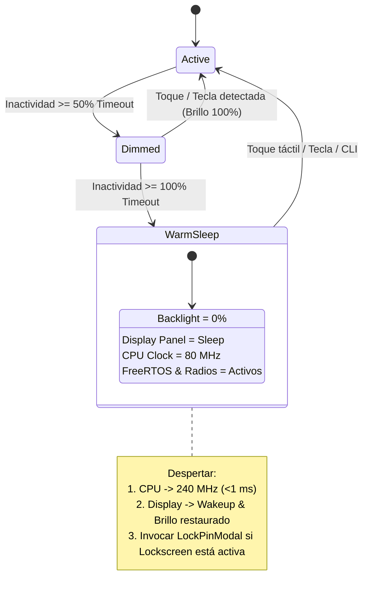

# 🔋 Propuesta Técnica: Rediseño de PowerManager (Reposo Activo a 80 MHz + Detección Global de Inactividad LVGL v9)

**Fecha:** 14 de Octubre de 2026  
**Estado:** Propuesta / En Revisión  
**Categoría:** Arquitectura Core / Gestión de Energía y Resiliencia UI  
**Autor:** Antigravity (Senior Embedded Systems Pair-Programmer) & CBDos Team  

---

## 🎯 1. Resumen Ejecutivo

Actualmente, el subsistema de gestión de energía ([core/src/system/PowerManager.cpp](file:///home/kaber420/Documentos/proyectos/cbdos/core/src/system/PowerManager.cpp)) presenta un defecto de diseño que provocaba que el sistema apagase la pantalla o entrase en suspensión de forma errática mientras el usuario interactuaba con el Cyberdeck. Además, contemplaba modos de bajo consumo disruptivos (*Deep Sleep* / *Light Sleep* con LP Core) que provocaban reinicios o congelamiento de tareas.

Esta propuesta define:
1. **La corrección radical del monitoreo de actividad**: Migrar del registro manual de callbacks en objetos pantalla a la API nativa de LVGL v9: `lv_display_get_inactive_time()`, garantizando detección omnicanal e infalible en cualquier widget, app o modal.
2. **Reposo Activo (*Warm Sleep / Active Idle*)**: Apagar el display y reducir la frecuencia del microcontrolador a **80 MHz** en lugar de apagar el chip. Esto ahorra más del 75% de batería preservando la memoria RAM/PSRAM, el árbol de LVGL, las tareas de FreeRTOS y los receptores de radio (ESP-NOW / BLE), logrando un despertar instantáneo (< 1 ms).

---

## 🔍 2. Diagnóstico Técnico del Problema Anterior

En la implementación previa ([PowerManager.cpp:L31-38](file:///home/kaber420/Documentos/proyectos/cbdos/core/src/system/PowerManager.cpp#L31-L38)):
```cpp
// Fallo de captura en init():
lv_display_t* disp = lv_display_get_default();
if (disp) {
    lv_obj_t* scr = lv_display_get_screen_active(disp);
    if (scr) {
        lv_obj_add_event_cb(scr, touchInputEventCb, LV_EVENT_PRESSED, this);
        lv_obj_add_event_cb(scr, touchInputEventCb, LV_EVENT_KEY, this);
    }
}
```

### Causas raíz identificadas:
1. **Pérdida de referencia por navegación de vistas**: El callback solo se registraba en la pantalla activa al momento del arranque. En cuanto el usuario abría otra vista (`lv_screen_load`), navegaba en el Dashboard o abría un modal (`LockPinModal`), la pantalla cambiaba y el callback quedaba desvinculado.
2. **Consumo de eventos por parte de widgets hijos**: En la jerarquía de LVGL, componentes como botones, teclados virtuales, sliders y listas consumen los eventos táctiles (`LV_EVENT_PRESSED`/`RELEASED`) sin propagarlos al objeto padre (`scr`).
3. **Efecto colateral**: El contador `m_lastActivityMs` dejaba de actualizarse, provocando que `update()` considerase erróneamente que el sistema estaba inactivo, apagando la pantalla en la cara del usuario.

---

## 🏗️ 3. Arquitectura Propuesta

### A. Monitoreo Global de Inactividad (LVGL v9 Nativo)
LVGL v9 mantiene un contador interno de inactividad a nivel de controlador de entrada (`lv_indev_t`) y display (`lv_display_t`).

* **Lectura**: En cada ciclo de `PowerManager::update()`:
  ```cpp
  lv_display_t* disp = lv_display_get_default();
  uint32_t inactiveMs = disp ? lv_display_get_inactive_time(disp) : 0;
  ```
* **Ventaja**: Detecta automáticamente **cualquier pulsación de tecla física, clic táctil o gesto**, sin importar en qué vista, widget o modal ocurra.
* **Reseteo manual**: Si un evento externo (ej. llegada de un paquete por radio o comando serial CLI) debe despertar la pantalla:
  ```cpp
  lv_display_trigger_activity(disp);
  ```

---

### B. Reposo Activo a 80 MHz (*Warm Sleep*)
En lugar de forzar modos destructivos que reseteen el SoC (Deep Sleep) o detengan el scheduler de FreeRTOS (Light Sleep puro):

1. **80 MHz como frecuencia óptima**:
   * El bus APB de periféricos del ESP32 opera a 80 MHz.
   * **RAM y PSRAM**: Refresco completo e ininterrumpido. No se pierde estado gráfico ni buffers de LVGL.
   * **Radio y Red**: Los subsistemas Wi-Fi, BLE y ESP-NOW pueden continuar recibiendo balizas y paquetes en segundo plano.
   * **Consola y UART**: Continúan recibiendo telemetría y comandos seriales sin desincronización de baudrate.
2. **Apagado del Display (Mayor consumidor de energía)**:
   * La retroiluminación LCD (Backlight) consume típicamente entre 80 mA y 200 mA.
   * Al apagar el backlight (PWM = 0) y poner el controlador del panel en reposo (`cbdos::display::panelSleep(true)`), el consumo global del Cyberdeck se reduce drásticamente (de ~250 mA a ~25-35 mA).
3. **Despertar Instantáneo**:
   * Salir de 80 MHz y volver a 240 MHz toma apenas unos microsegundos.
   * Al primer contacto con la pantalla o teclado, el hardware ya está a máxima potencia antes de que el dedo se levante.

---

## 🔄 4. Máquina de Estados de Energía



---

## 📐 5. Plan de Implementación Detallado

### Paso 1: Refactorización de `core/src/system/PowerManager.cpp`
* Eliminar el registro frágil `lv_obj_add_event_cb(scr, ...)`.
* En `update()`, consultar `lv_display_get_inactive_time()`.
* Introducir el estado `PowerState::WarmSleep` (reemplazando la ambigüedad entre `ScreenOff` y `LightSleep`).
* En `turnOffScreen()` / `enterWarmSleep()`:
  * Poner brillo a 0.
  * Notificar al HAL de sistema para downclock a 80 MHz (`cbdos::system::setCpuFrequencyMhz(80)`).
* En `wakeUp()`:
  * Subir CPU a frecuencia nativa (`cbdos::system::setCpuFrequencyMhz(240)`).
  * Encender panel y restaurar brillo.
  * Validar política de seguridad de `LockService` (desplegar `LockPinModal` si aplica).

### Paso 2: Abstracción en `core/include/cbdos/system.hpp`
* Agregar las APIs de control de frecuencia en el Core:
  ```cpp
  namespace cbdos {
  namespace system {
      void setCpuFrequencyMhz(uint32_t freqMhz);
      uint32_t getCpuFrequencyMhz();
  }
  }
  ```

### Paso 3: Implementación en BSPs
* **ESP32-S3 (`bsp/esp32_s3_jc3248`)**:
  ```cpp
  void setCpuFrequencyMhz(uint32_t freqMhz) {
      ::setCpuFrequencyMhz(freqMhz);
  }
  ```
* **ESP32-P4 (`bsp/esp32_p4_jc4880`)**:
  * Utilizar `esp_pm_configure()` o API de reloj de ESP-IDF 5.5 para regular el reloj entre 80 MHz y la frecuencia nominal (400/240 MHz).

---

## 🛡️ 6. Criterios de Aceptación y Pruebas
1. **Prueba de Navegación**: Navegar entre 5 vistas y modales distintos sin que la pantalla se apague prematuramente mientras haya actividad continua.
2. **Prueba de Atenuación**: Dejar el dispositivo quieto; comprobar que a los `timeout / 2` segundos el brillo baja al 20%.
3. **Prueba de Reposo Activo**: Cumplido el 100% del timeout, la pantalla se apaga completamente.
4. **Prueba de Tareas de Fondo en Reposo**: Con la pantalla apagada a 80 MHz, verificar por log serial que las tareas de radio (ESP-NOW / LAN Recon) continúan ejecutándose.
5. **Prueba de Despertar Inmediato**: Al tocar la pantalla apagada, la pantalla enciende de inmediato (<1 ms de latencia percibida), el CPU sube a 240 MHz y, si está configurado, solicita el PIN de seguridad.
