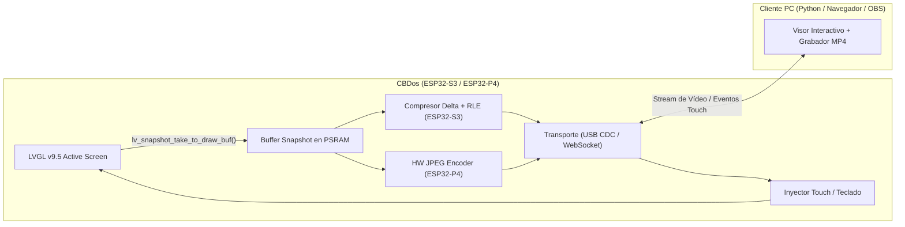

# Propuesta y Plan de Arquitectura: Screen Share y Grabación de Pantalla en PC (CBDos)

> **Estado:** Propuesta Técnica / Plan de Arquitectura  
> **Fecha:** 19 de Octubre de 2026  
> **Targets:** ESP32-S3 (JC3248W535) y ESP32-P4 (JC4880P443C)  
> **Framework Gráfico:** LVGL v9.5 estricto  

---

## 1. Objetivo
Permitir capturar en tiempo real la interfaz LVGL v9.5 de **CBDos** y transmitirla a la PC por **USB** o **Wi-Fi (WebSocket/HTTP)** para grabación de vídeo (`.mp4`/`.gif`), streaming directo en **OBS Studio** y control táctil remoto desde el PC, sin bloquear el bucle de renderizado de la UI ni requerir cámaras externas apuntando a la pantalla.

---

## 2. Arquitectura en el Firmware (`core/services/ScreenShareService`)



### 2.1 Captura Segura en LVGL v9.5 (Core Agnóstico)
1. **Buffer en PSRAM bajo demanda:** Al activar el servicio (por comando serie o switch en UI, ocupando **0 bytes de RAM cuando está apagado**), se reserva en PSRAM un `lv_draw_buf_t` con formato `LV_COLOR_FORMAT_RGB565`.
   - **ESP32-S3 (320×480):** `307,200 bytes` (~300 KB en PSRAM).
   - **ESP32-P4 (480×800):** `768,000 bytes` (~750 KB en Hexal-PSRAM).
2. **Sincronización Reactiva (Cero Polling Innecesario):**
   - Se engancha al evento de refresco de pantalla de LVGL v9.5 y solo captura cuando la pantalla ha tenido áreas sucias (*dirty areas*) reales.
   - Toma el snapshot bajo el mutex de LVGL con `lv_snapshot_take_to_draw_buf(lv_screen_active(), LV_COLOR_FORMAT_RGB565, &m_snapBuf)` y libera inmediatamente el mutex antes de comprimir y transmitir.

---

## 3. Codificación Según Plataforma (HAL)

Dado que enviar frames crudos RGB565 por serie saturaría el bus (300 KB en S3 / 750 KB en P4 por frame), el empaquetado se divide en dos estrategias:

### A. Estrategia ESP32-S3: Tiras Dirty + RLE (Run-Length Encoding)
- Divide la pantalla de 320×480 en tiras horizontales de `8` o `16` filas (`320 × 8 × 2 = 5,120 bytes`).
- Compara por `memcmp` de 32 bits cada tira con el frame previo en PSRAM: **las tiras que no cambiaron no se envían**.
- Las tiras modificadas se comprimen con **RLE RGB565** (las interfaces gráficas tienen grandes áreas de color sólido en fondos, barras y botones, logrando ratios de compresión de 5:1 a 15:1).
- **Resultado estimado en S3:** 5 KB – 20 KB por frame cambiado (~15–25 FPS por USB-Serial-JTAG o WebSocket).

### B. Estrategia ESP32-P4: Acelerador Hardware JPEG (`driver/jpeg_encode.h`)
- El **ESP32-P4** cuenta con periférico **Hardware JPEG Encoder** dedicado con DMA directo desde Hexal-PSRAM.
- El buffer RGB565 de 480×800 se comprime por hardware a JPEG (calidad 80%) en **~2.5 ms** sin carga de CPU, reduciendo los 768 KB a **~20–35 KB por frame**.
- **Resultado estimado en P4:** Stream **MJPEG nativo a 30–60 FPS** por USB High-Speed (480 Mbps) o Wi-Fi SDIO.

---

## 4. Protocolo de Trama y Control Táctil Remoto

### 4.1 Formato de Paquete (Device $\to$ PC)
Para no interferir con los logs normales de consola cuando se usa USB-Serial-JTAG o un endpoint secundario:
```text
[MAGIC: "CBSS" (4B)] [TYPE: u8] [SEQ: u16] [Y_OFFSET: u16] [HEIGHT: u16] [PAYLOAD_LEN: u32] [PAYLOAD...] [CRC16: u16]
```
- `TYPE = 0x01`: Tira RGB565 comprimida con RLE (S3 / fallback P4).
- `TYPE = 0x02`: Frame completo JPEG comprimido por hardware (P4).

### 4.2 Inyección Táctil Remota (PC $\to$ Device)
Comandos por consola serie / canal de retorno para operar CBDos desde la ventana de grabación en el PC:
- `CBDOS:SCREEN:START` / `CBDOS:SCREEN:STOP` — Activa/desactiva la transmisión y libera la PSRAM al parar.
- `CBDOS:TOUCH:<DOWN|MOVE|UP>:<x>:<y>` — Inyecta coordenadas directamente en el `lv_indev_t` táctil de LVGL v9.5.

---

## 5. Herramienta de Grabación en PC (`tools/cbdos_recorder.py`)
Un script ligero en Python (`pyserial`, `pygame`/`opencv-python` y `ffmpeg`) que:
1. Se conecta al puerto serie (`/dev/ttyACM0`) o IP de CBDos y envía `CBDOS:SCREEN:START`.
2. Muestra la pantalla de CBDos en vivo en una ventana de escritorio a escala 1:1 o 2x.
3. Permite grabar directamente a **`.mp4` (H.264 a 60 FPS)** o **`.gif`** pulsando una tecla (`R`), guardando los vídeos listos para subir o documentar.
4. Permite hacer clic y arrastrar con el ratón sobre la ventana del PC para controlar CBDos en tiempo real mientras se graba.
5. Expone opcionalmente un servidor local MJPEG (`http://localhost:8080/stream.mjpeg`) para añadirlo como fuente **"Navegador / Media Source" directamente en OBS Studio**.

---

## 6. Fases de Implementación
1. **Fase 1 (Core):** Crear `core/services/ScreenShareService.hpp/.cpp` con captura `lv_snapshot_take_to_draw_buf` en PSRAM, delta de tiras y compresor RLE RGB565.
2. **Fase 2 (Comandos Consola + Touch):** Registrar comandos `CBDOS:SCREEN:START/STOP` y `CBDOS:TOUCH` en la consola del sistema.
3. **Fase 3 (Aceleración P4):** Conectar el encoder JPEG por hardware del ESP32-P4 en su BSP.
4. **Fase 4 (Cliente PC):** Crear `tools/cbdos_recorder.py` con visualización en vivo, grabación a `.mp4` y soporte OBS.
